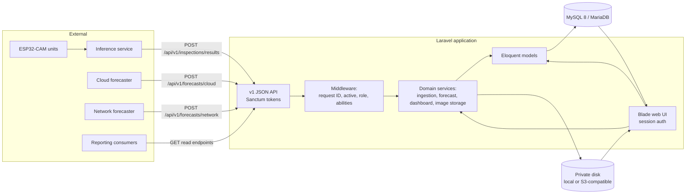
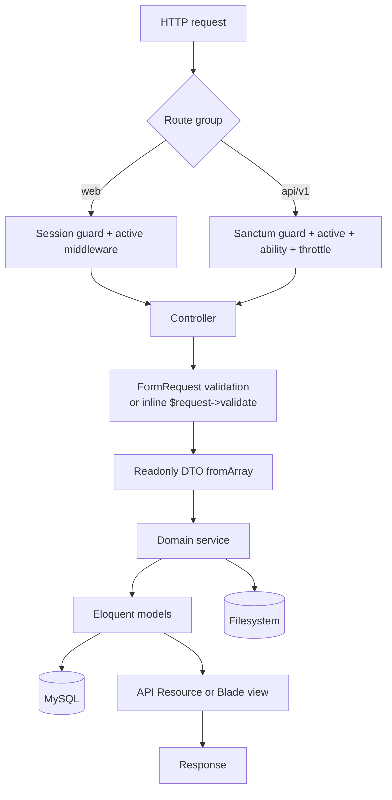
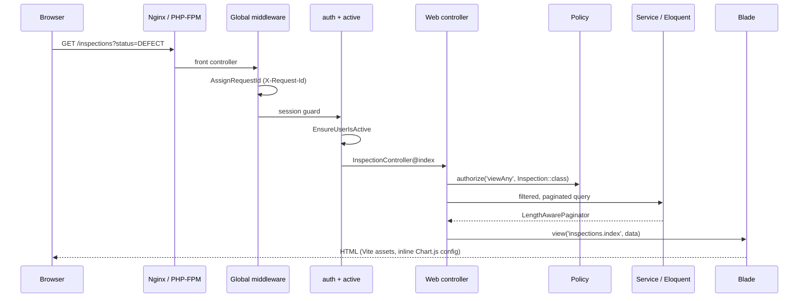
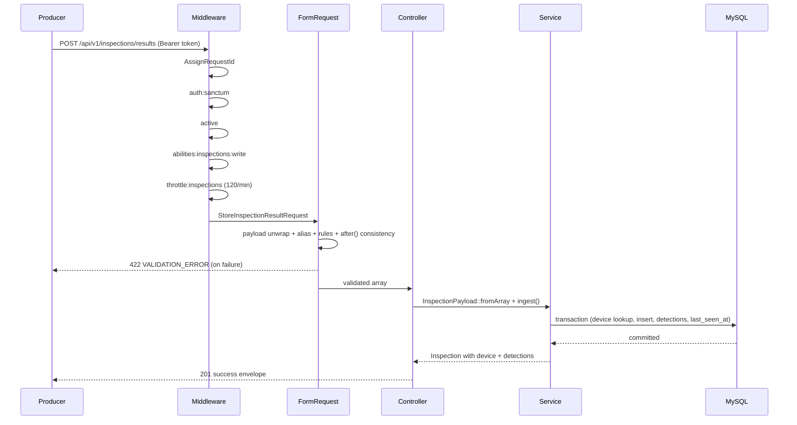
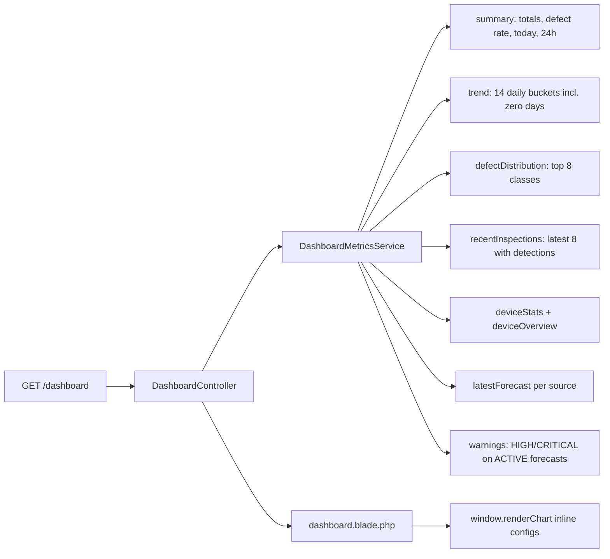

# 03 — System Architecture

## Architectural style

A **monolithic Laravel 12 web application** with two entry surfaces:

1. **Server-rendered Blade UI** — session-authenticated dashboards and management screens.
2. **Versioned JSON API** — Sanctum-token-authenticated machine and integration endpoints.

There is no separate frontend service, no message broker, no worker tier, and no inference component
in this repository.

## High-level system architecture



Notes:

- Arrows from `API`/`WEB` into `SVC`/`ELQ` are simplified; controllers call services and models
  directly rather than through a repository interface.
- Images are written by `ImageStorageService` and read back only through authorised routes or
  temporary URLs.
- No component calls outbound to the inference or forecasting services. Integration is inbound only.

## Runtime components

| Component | Implementation | Notes |
| --- | --- | --- |
| Web server | Nginx | `docker/nginx.conf`, listens on port 80 |
| PHP runtime | PHP-FPM 8.3 | `php:8.3-fpm-alpine` |
| Process manager | Supervisor | `docker/supervisord.conf` runs Nginx + PHP-FPM |
| Application | Laravel 12 | Front controller `public/index.php` |
| Database | MySQL 8.4 / MariaDB 10.4+ | Single connection `mysql` |
| Storage | Local private disk or S3-compatible | Selected by `INSPECTION_IMAGE_DISK` |
| Health probe | `/up` (framework) and `/api/v1/health` (application) | Container healthcheck uses `/up` |

## Application layering



| Layer | Location | Responsibility |
| --- | --- | --- |
| Routing | `routes/web.php`, `routes/api.php`, `routes/auth.php`, `routes/console.php` | Endpoint definitions, middleware groups, names |
| Middleware | `app/Http/Middleware/` | Request ID, active-account gate, role gate |
| HTTP validation | `app/Http/Requests/` | API ingestion contracts, web form validation |
| Controllers | `app/Http/Controllers/` | Orchestration only; thin |
| DTOs | `app/Data/` | Immutable payload objects with `fromArray()` and consistency rules |
| Services | `app/Services/` | Transactions, ingestion, aggregation, presentation, storage |
| Models | `app/Models/` | Relationships, casts, scopes, small domain helpers |
| Resources | `app/Http/Resources/` | API serialisation |
| Enums | `app/Enums/` | Status/role/risk vocabularies plus label/colour helpers |
| Support | `app/Support/ApiResponse.php`, `app/Support/helpers.php` | Envelope construction and display helpers |
| Exceptions | `app/Exceptions/ApiException.php` | Stable machine-readable API failures |
| Policies | `app/Policies/` | Role/ownership rules for web actions |
| Views | `resources/views/` | Blade layouts, pages, components |

## Request lifecycle

### Web request



Unhandled exceptions on web routes use Laravel's standard HTML error pages, with custom
`resources/views/errors/{403,404,419,429,500}.blade.php` templates.

### API request



Exception rendering for `api/*` is registered in `bootstrap/app.php` and converts:

| Exception | HTTP | Error code |
| --- | --- | --- |
| `ApiException` | its status | its code (`DUPLICATE_INSPECTION`, `CONTRACT_MISMATCH`, …) |
| `ValidationException` | 422 | `VALIDATION_ERROR` |
| `AuthenticationException` | 401 | `UNAUTHENTICATED` |
| `AccessDeniedHttpException` | 403 | `FORBIDDEN` |
| `NotFoundHttpException` | 404 | `NOT_FOUND` |
| `TooManyRequestsHttpException` | 429 | `RATE_LIMITED` |
| other `HttpExceptionInterface` | its status | `HTTP_ERROR` |
| any other `Throwable` | 500 | `SERVER_ERROR` |

## Inspection ingestion data flow

```mermaid
flowchart TD
    A[Multipart or JSON request] --> B{payload field present?}
    B -->|yes| C[Decode JSON string or merge array]
    B -->|no| D[Use top-level fields]
    C --> E[device_id -> device_code alias]
    D --> E
    E --> F[Validation rules]
    F -->|fail| X[422 VALIDATION_ERROR]
    F --> G[after(): defect_count == detections, status matches, clock window]
    G -->|fail| X
    G --> H[InspectionPayload::fromArray]
    H --> I{isConsistent?}
    I -->|no| Y[422 CONTRACT_MISMATCH]
    I --> J{device_code exists?}
    J -->|no| Z[422 UNKNOWN_DEVICE]
    J --> K{inspection_id already stored?}
    K -->|yes| W[409 DUPLICATE_INSPECTION]
    K --> L[DB transaction]
    L --> M[Store image if supplied]
    M --> N[Insert inspection]
    N --> O[Insert detections]
    O --> P[Update device.last_seen_at]
    P --> Q[Commit]
    Q -->|failure| R[Delete stored image, rollback]
    Q --> S[201 response]
```

Key invariant: the service re-checks consistency even though the FormRequest already does, so the
contract holds for any future caller. Duplicate-key SQL errors (`1062`) are also translated to
`409 DUPLICATE_INSPECTION`, which closes the race between the pre-check and the insert.

## Forecast ingestion data flow

```mermaid
flowchart TD
    A[POST forecasts/cloud or /network] --> B[StoreCloud/NetworkForecastRequest]
    B --> C[Rules: uuid, horizon, predictions 1..500]
    C --> D[after(): unique metric+timestamp, generated_at <= now+5m]
    D -->|fail| X[422 VALIDATION_ERROR]
    D --> E[ForecastPayload::fromArray]
    E --> F{exists source_type + external_id?}
    F -->|yes| Y[409 DUPLICATE_FORECAST]
    F --> G[DB transaction]
    G --> H[Set existing ACTIVE rows for source -> SUPERSEDED]
    H --> I[Insert forecast ACTIVE]
    I --> J[Insert predictions]
    J --> K[Commit]
    K --> L[201 response with predictions]
```

Consequence: **exactly one `ACTIVE` forecast per source is the intended invariant**, produced by the
supersede update. This is enforced by application logic, not by a database constraint, so concurrent
ingestions could theoretically produce two active rows. See
[16](16-known-limitations-and-technical-debt.md).

## Dashboard and presentation flow



Forecast pages use `ForecastPresentationService::series()` to turn stored predictions into
chart-ready series. Metrics absent from a forecast are **not** synthesised; only metrics with stored
predictions appear.

## Integration boundaries

| Boundary | Inbound | Outbound |
| --- | --- | --- |
| Inference service | Inspection results + optional image | JSON acknowledgement or error envelope |
| Cloud/network forecasters | Forecast + predictions | JSON acknowledgement or error envelope |
| Reporting consumers | — | Paginated read API |
| MySQL | — | SQL via Eloquent/query builder |
| Object storage | — | Image writes, existence checks, temporary URL generation |
| AWS services | — | None directly; the container reads environment/secrets injected by the platform |

There are no outbound HTTP calls in application code. `grep` for `Http::` finds no usage.

## Security architecture

- Session cookies for the UI; Sanctum bearer tokens for the API.
- CSRF protection on all web POST/PUT/PATCH/DELETE forms (Laravel default).
- Service accounts cannot obtain a session (`LoginRequest` rejects `isService()`).
- Inactive accounts are rejected by `EnsureUserIsActive` on both surfaces.
- Policies enforce device/inspection/forecast/user rules in addition to route middleware.
- Images live on a private disk; the UI route authorises then streams (local) or redirects to a
  10-minute temporary URL (S3).
- Rate limiters are per user ID (API) or IP (health).
- Secrets are environment-injected; nothing is committed.

## Related documents

- Database detail: [05-database-design.md](05-database-design.md)
- Backend internals: [06-backend-architecture.md](06-backend-architecture.md)
- API contracts: [07-api-documentation.md](07-api-documentation.md)
- Deployment topology: [14-deployment-and-infrastructure.md](14-deployment-and-infrastructure.md)
