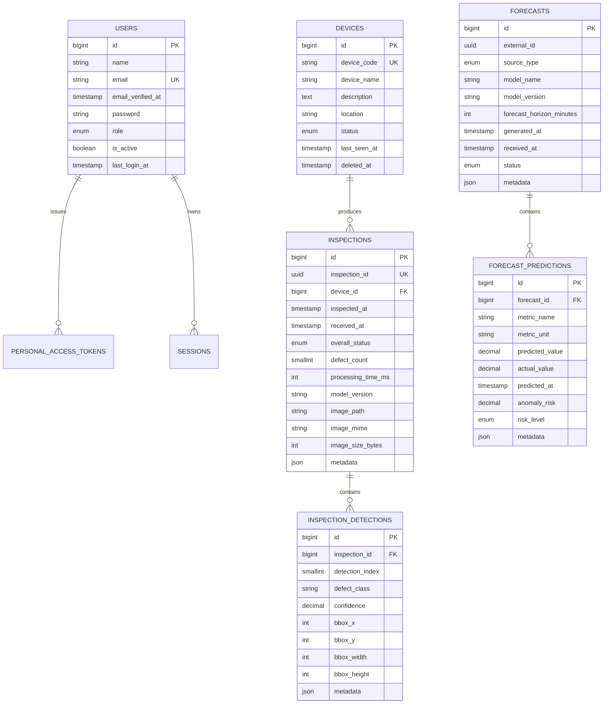

# 05 — Database Design

Driver: `mysql` (MySQL 8.4 in containers/CI, MariaDB 10.4+ locally). Charset/collation come from
`config/database.php` defaults (`utf8mb4` / `utf8mb4_unicode_ci`). Strict mode is enabled.

Databases:

| Purpose | Name | Configured in |
| --- | --- | --- |
| Development | `garment_defect` | `.env` / `.env.example` |
| Tests | `garment_defect_test` | `phpunit.xml` |

## Entity relationship diagram

`PERSONAL_ACCESS_TOKENS` and `SESSIONS` are drawn for completeness; they are framework/Sanctum tables,
not application domain entities.

## Tables

### `users`

Created by `0001_01_01_000000_create_users_table.php`.

| Column | Type | Constraints |
| --- | --- | --- |
| `id` | bigint unsigned | PK, auto-increment |
| `name` | varchar(255) | required |
| `email` | varchar(255) | unique |
| `email_verified_at` | timestamp | nullable |
| `password` | varchar(255) | hashed cast |
| `role` | enum(`ADMINISTRATOR`,`OPERATOR`,`SERVICE`) | default `OPERATOR`, indexed |
| `is_active` | boolean | default true, indexed |
| `last_login_at` | timestamp | nullable |
| `remember_token` | varchar(100) | nullable |
| `created_at`, `updated_at` | timestamp | |

Notes:

- `email_verified_at` is populated by the seeder but **email verification is not routed**.
- No soft deletes; deactivation is `is_active = false`.
- `password_reset_tokens` exists from the same migration but no password-reset route uses it.

### `devices`

| Column | Type | Constraints |
| --- | --- | --- |
| `id` | bigint unsigned | PK |
| `device_code` | varchar(50) | unique |
| `device_name` | varchar(100) | required |
| `description` | text | nullable |
| `location` | varchar(150) | nullable |
| `status` | enum(`ACTIVE`,`INACTIVE`,`MAINTENANCE`) | default `ACTIVE`, indexed |
| `last_seen_at` | timestamp | nullable, indexed |
| `created_at`, `updated_at` | timestamp | |
| `deleted_at` | timestamp | nullable (soft deletes) |

Indexes: unique `device_code`, index `status`, index `last_seen_at`.

Soft deletes are configured but unused by any route.

### `inspections`

| Column | Type | Constraints |
| --- | --- | --- |
| `id` | bigint unsigned | PK |
| `inspection_id` | uuid (char 36) | **unique** — idempotency key |
| `device_id` | bigint unsigned | FK → `devices.id`, `restrictOnDelete` |
| `inspected_at` | timestamp | indexed |
| `received_at` | timestamp | nullable |
| `overall_status` | enum(`PASS`,`DEFECT`) | indexed |
| `defect_count` | smallint unsigned | default 0 |
| `processing_time_ms` | int unsigned | nullable |
| `model_version` | varchar(50) | required |
| `image_path` | varchar(255) | nullable |
| `image_mime` | varchar(50) | nullable |
| `image_size_bytes` | int unsigned | nullable |
| `metadata` | json | nullable |
| `created_at`, `updated_at` | timestamp | |

Indexes: unique `inspection_id`, `inspected_at`, composite `(device_id, inspected_at)`,
composite `(overall_status, inspected_at)`.

`restrictOnDelete` means a device with inspections cannot be hard-deleted.

### `inspection_detections`

| Column | Type | Constraints |
| --- | --- | --- |
| `id` | bigint unsigned | PK |
| `inspection_id` | bigint unsigned | FK → `inspections.id`, `cascadeOnDelete` |
| `detection_index` | smallint unsigned | default 0 (0-based order) |
| `defect_class` | varchar(50) | indexed |
| `confidence` | decimal(5,4) | 0.0000–1.0000 enforced by validation |
| `bbox_x`, `bbox_y` | int unsigned | nullable |
| `bbox_width`, `bbox_height` | int unsigned | nullable |
| `metadata` | json | nullable |
| `created_at`, `updated_at` | timestamp | |

Indexes: composite `(inspection_id, detection_index)`, index `defect_class`.

Bounding-box columns are stored flat; `InspectionDetection::boundingBox()` reconstructs the nested
API shape and returns `null` unless both width and height are present.

### `forecasts`

| Column | Type | Constraints |
| --- | --- | --- |
| `id` | bigint unsigned | PK |
| `external_id` | uuid | comes from producer `forecast_id` |
| `source_type` | enum(`CLOUD`,`NETWORK`) | indexed |
| `model_name` | varchar(100) | required |
| `model_version` | varchar(50) | required |
| `forecast_horizon_minutes` | int unsigned | required |
| `generated_at` | timestamp | indexed |
| `received_at` | timestamp | nullable |
| `status` | enum(`ACTIVE`,`SUPERSEDED`,`EXPIRED`) | default `ACTIVE`, indexed |
| `metadata` | json | nullable |
| `created_at`, `updated_at` | timestamp | |

Indexes: **unique `(source_type, external_id)`**, composite `(source_type, generated_at)`, composite
`(source_type, status, generated_at)`.

`external_id` is unique only per source: the same UUID may exist once under `CLOUD` and once under
`NETWORK`.

### `forecast_predictions`

| Column | Type | Constraints |
| --- | --- | --- |
| `id` | bigint unsigned | PK |
| `forecast_id` | bigint unsigned | FK → `forecasts.id`, `cascadeOnDelete` |
| `metric_name` | varchar(50) | required |
| `metric_unit` | varchar(20) | nullable |
| `predicted_value` | decimal(20,6) | required |
| `actual_value` | decimal(20,6) | nullable |
| `predicted_at` | timestamp | required |
| `anomaly_risk` | decimal(5,4) | nullable, 0–1 enforced by validation |
| `risk_level` | enum(`LOW`,`MEDIUM`,`HIGH`,`CRITICAL`) | nullable, indexed |
| `metadata` | json | nullable |
| `created_at`, `updated_at` | timestamp | |

Indexes: unique `(forecast_id, metric_name, predicted_at)` named
`forecast_predictions_metric_unique`; composite `(metric_name, predicted_at)`.

### Framework tables

| Table | Source | Used |
| --- | --- | --- |
| `personal_access_tokens` | Sanctum migration | Yes — API tokens |
| `sessions` | users migration | Yes when `SESSION_DRIVER=database` |
| `cache`, `cache_locks` | cache migration | Yes when `CACHE_STORE=database` |
| `password_reset_tokens` | users migration | No — no reset route |
| `jobs`, `job_batches`, `failed_jobs` | jobs migration | No — no dispatched jobs |

## Enumerations

| PHP enum | Column | Cases |
| --- | --- | --- |
| `App\Enums\Role` | `users.role` | `ADMINISTRATOR`, `OPERATOR`, `SERVICE` |
| `App\Enums\DeviceStatus` | `devices.status` | `ACTIVE`, `INACTIVE`, `MAINTENANCE` |
| `App\Enums\InspectionStatus` | `inspections.overall_status` | `PASS`, `DEFECT` |
| `App\Enums\ForecastSource` | `forecasts.source_type` | `CLOUD`, `NETWORK` |
| `App\Enums\ForecastStatus` | `forecasts.status` | `ACTIVE`, `SUPERSEDED`, `EXPIRED` |
| `App\Enums\RiskLevel` | `forecast_predictions.risk_level` | `LOW`, `MEDIUM`, `HIGH`, `CRITICAL` |

All models cast their enum columns to the corresponding PHP enum. Comparisons in code use cases
(for example `ForecastStatus::Active`), not raw strings.

## Relationships

| Model | Relationship | Type |
| --- | --- | --- |
| `User` | `tokens()` | `HasApiTokens` (morph many personal access tokens) |
| `Device` | `inspections()` | `hasMany` |
| `Device` | `latestInspection()` | `hasOne(...)->latestOfMany('inspected_at')` |
| `Inspection` | `device()` | `belongsTo` |
| `Inspection` | `detections()` | `hasMany` ordered by `detection_index` |
| `InspectionDetection` | `inspection()` | `belongsTo` |
| `Forecast` | `predictions()` | `hasMany` ordered by `predicted_at` |
| `ForecastPrediction` | `forecast()` | `belongsTo` |

`Inspection::getRouteKeyName()` returns `inspection_id`, so web and API URLs use the UUID rather than
the numeric key. `Device`, `User`, and `Forecast` use numeric route keys.

## Data integrity rules

Enforced in application code, not all in the schema:

1. `defect_count == count(detections)`.
2. `overall_status == DEFECT` when there is ≥1 detection, otherwise `PASS`.
3. `inspected_at` must be within `INSPECTION_BACKFILL_DAYS` (default 7) and no more than
   `INSPECTION_FUTURE_TOLERANCE_MINUTES` (default 5) in the future.
4. `confidence` and `anomaly_risk` are within `[0, 1]`.
5. Duplicate `(metric_name, predicted_at)` within one forecast payload is rejected.
6. `generated_at` may not be more than 5 minutes in the future (hardcoded tolerance in the request).
7. At most one `ACTIVE` forecast per source — enforced procedurally during ingestion.
8. At least one active administrator must remain; administrators cannot demote/deactivate themselves.

## Retention

There is **no retention or purge mechanism**. Inspections, detections, forecasts, predictions, and
images accumulate indefinitely. Any retention feature must be added deliberately, including image
cleanup, because the cascade only covers database rows.

## Test database

- `phpunit.xml` sets `DB_CONNECTION=mysql`, `DB_HOST=127.0.0.1`, `DB_PORT=3306`,
  `DB_DATABASE=garment_defect_test`, `DB_USERNAME=root`, empty password.
- Feature tests use `RefreshDatabase`, which migrates the test database and wraps each test.
- The test database must exist before running the suite.
- Tests also set `CACHE_STORE=array`, `BROADCAST_CONNECTION=null`, and
  `INSPECTION_IMAGE_DISK=local`.

## Changing the schema

- Add a new timestamped migration in `database/migrations/`.
- Update the model `$fillable`/`casts()` and any factory, resource, request, and test that touches the
  column.
- Consider consumers: API field names, Blade forms, filters, and chart data.
- Do not rename or drop columns without checking `docs/database.md`, `docs/integration-contracts.md`,
  and `docs/api.md` for documented contracts.
- For new enum values, update both the PHP enum and the migration column definition, and verify
  `docs/` references.
