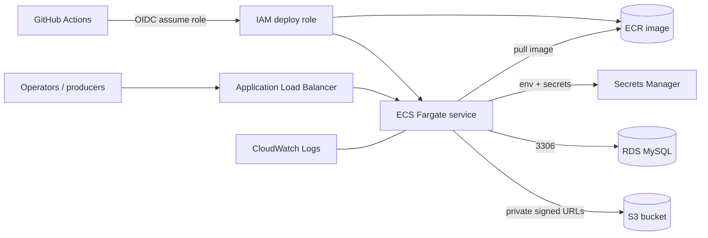

# 14 — Deployment and Infrastructure

This document describes what is implemented in the repository. **AWS resources are not provisioned**
by this project; templates and workflows exist, but no cloud infrastructure is live.

For exhaustive provisioning steps, see [`../docs/deployment.md`](../docs/deployment.md) and
[`../docs/aws-oidc.md`](../docs/aws-oidc.md).

## Container image

`docker/Dockerfile` is a three-stage build:

| Stage | Base | Purpose |
| --- | --- | --- |
| `assets` | `node:22-alpine` | `npm ci` + `npm run build` into `/app/public/build` |
| `vendor` | `composer:2` | Production Composer install (`--no-dev`), optimised classmap |
| `runtime` | `php:8.3-fpm-alpine` | Nginx + PHP-FPM + Supervisor |

Runtime details:

- Installs `nginx`, `supervisor`, `curl`, `icu-libs`, `oniguruma`, `libzip`, `tzdata`.
- Builds PHP extensions `pdo_mysql`, `bcmath`, `opcache`, `pcntl`; removes build deps.
- Copies `docker/php.ini`, `docker/nginx.conf`, `docker/supervisord.conf`, `docker/entrypoint.sh`.
- Creates and chowns `storage/*` and `bootstrap/cache`.
- Default env: `APP_ENV=production`, `APP_DEBUG=false`, `LOG_CHANNEL=stderr`, `CACHE_STORE=file`,
  `SESSION_DRIVER=file`, `QUEUE_CONNECTION=sync`, `RUN_MIGRATIONS=false`.
- Exposes port 80.
- Healthcheck: `curl --fail http://127.0.0.1/up` every 30s (start period 20s, 3 retries).
- Entrypoint runs `supervisord`.

No assets, `.env`, or secrets are baked in beyond defaults.

## Entrypoint behaviour (`docker/entrypoint.sh`)

1. `set -eu`; cd to `/var/www/html`.
2. Prepare writable directories and permissions.
3. If `APP_KEY` is empty:
   - Production → log error and exit 1.
   - Other environments → generate an ephemeral key.
4. If `WAIT_FOR_DB` is truthy → poll PDO up to `DB_WAIT_ATTEMPTS` (default 30, 2s interval).
5. If `RUN_MIGRATIONS` is truthy → `php artisan migrate --force --no-interaction`.
6. If `RUN_SEED` is truthy → `php artisan db:seed --force --no-interaction`.
7. If `OPTIMIZE` (default true) → cache config, routes, views, events.
8. Re-chown caches, then `exec "$@"`.

`RUN_SEED=true` on every restart resets seeded account passwords; set it to `false` after the first
start in shared environments.

## Docker Compose (local/demo)

`docker-compose.yml`:

| Service | Image | Notes |
| --- | --- | --- |
| `app` | built from `docker/Dockerfile` (`garment-defect:local`) | Port `${APP_PORT:-8080}:80`; volumes for storage/logs; waits for healthy DB |
| `db` | `mysql:8.4` | Port `${DB_PORT_FORWARD:-3307}:3306`; named volume `db-data`; healthcheck via `mysqladmin ping` |

Environment is shared through the `x-app-environment` anchor. Required variables without defaults:
`DB_PASSWORD`, `DB_ROOT_PASSWORD`, `ADMIN_PASSWORD`, `OPERATOR_PASSWORD`.

Start:

```bash
cp .env.docker.example .env.docker
# replace every change-me value
docker compose --env-file .env.docker up --build
```

Application: `http://localhost:8080`.

### S3 overlay

`docker-compose.s3.yml` adds `minio` and `minio-init` (creates a private bucket). Start with:

```bash
docker compose --env-file .env.docker \
  -f docker-compose.yml -f docker-compose.s3.yml up --build
```

## CI (`.github/workflows/ci.yml`)

Triggers: pushes to `master` and `main`, all pull requests, manual dispatch. Concurrency cancels superseded runs.

### `backend` job

- Ubuntu, MySQL 8.4 service database `garment_defect_test`.
- PHP 8.3 with `mbstring, pdo_mysql, bcmath, gd, intl, zip, pcntl`.
- Node 22 with npm cache.
- Steps: composer install → copy `.env.example` → `key:generate` → `npm ci` → `npm run build` →
  `php artisan test` → `vendor/bin/pint --test` → `php artisan view:cache`.

### `container` job

- Depends on `backend`.
- Buildx build of `docker/Dockerfile` (loads locally, no push).
- Runs the image on the host network with `APP_ENV=production`, a generated `APP_KEY`, MySQL env,
  `RUN_MIGRATIONS=true`, `WAIT_FOR_DB=true`.
- Polls `http://127.0.0.1/up` for up to 45 attempts × 2s, then calls `/api/v1/health`.
- Dumps logs and removes the container on exit.

## Deploy workflow (`.github/workflows/deploy.yml`)

Triggers: tags matching `v*`, or manual dispatch with an optional `image_tag`.

Permissions: `id-token: write`, `contents: read`. Environment: `production`.

Required repository **variables**:

| Variable | Purpose |
| --- | --- |
| `AWS_REGION` | Target region |
| `ECR_REPOSITORY` | Image repository name |
| `ECS_CLUSTER` | ECS cluster |
| `ECS_SERVICE` | ECS service |
| `ECS_TASK_FAMILY` | Task definition family |
| `ECS_SUBNET_IDS` | Optional, enables migration task |
| `ECS_SECURITY_GROUP_IDS` | Optional, enables migration task |

Required repository **secret**: `AWS_DEPLOY_ROLE_ARN` (OIDC-assumed role).

Steps:

1. Validate that all required variables/secret are set.
2. Configure AWS credentials via OIDC (`aws-actions/configure-aws-credentials@v4`).
3. Log in to ECR.
4. Resolve image tag (input or commit SHA).
5. Build and push two tags: the resolved tag and `latest`.
6. Register a new task-definition revision by patching the current definition's image with `jq`.
7. If subnet/security-group variables are set, run a one-off Fargate task
   `php artisan migrate --force --no-interaction` and fail on non-zero exit.
8. `aws ecs update-service --force-new-deployment` and wait for stability.
9. Write a deployment summary.

The workflow does **not** seed or issue tokens; those are operational steps.

## ECS task template (`docker/ecs-task-definition.json`)

- Family `garment-defect`, Fargate, `awsvpc`, 512 CPU / 1024 MB.
- Container `app`, port 80, image placeholder `<ACCOUNT_ID>.dkr.ecr.<REGION>...`.
- Environment includes production flags, RDS placeholders, `s3` disks, `RUN_MIGRATIONS=false`,
  `RUN_SEED=false`, `WAIT_FOR_DB=true`, `OPTIMIZE=true`.
- `APP_KEY` and `DB_PASSWORD` are referenced from Secrets Manager ARNs, not inline.
- Execution role `garment-defect-execution`, task role `garment-defect-task`.

## AWS reference topology (templates only)



Provisioning (ECR, RDS, S3, IAM, ALB, ECS cluster/service, log group, secret rotation) is described in
`docs/deployment.md` and is **not** automated here.

## Operational configuration matrix

| Concern | Compose | ECS template |
| --- | --- | --- |
| Cache | `database` | `database` |
| Session | `database` | `database` |
| Queue | `sync` | `database` (no workers) |
| Images | local volume or MinIO | S3 |
| Migrations | entrypoint `RUN_MIGRATIONS=true` | one-off deploy task |
| Seeding | `RUN_SEED=true` (first start) | `false` |
| Secrets | `.env.docker` | Secrets Manager |
| TLS | none (HTTP :8080) | ALB/ACM (not in repo) |

## Health and observability

| Probe | Path | Behaviour |
| --- | --- | --- |
| Container/framework | `/up` | 200 when the app boots |
| API | `/api/v1/health` | 200/503 with database status |
| Logs | stdout/stderr | `LOG_CHANNEL=stderr` in containers |

No metrics, tracing, or alerting configuration is included. Application logs two ingestion events
and reports unexpected API exceptions.

## Scaling and state

- The app is stateless when images are on S3 and sessions/cache are in the database.
- With `file` sessions/cache and local images, multiple replicas are **not** safe (sticky sessions and
  shared storage would be required).
- No queue workers are required because no jobs are dispatched.
- ECS template provisions a single container definition; autoscaling is not configured.

## Rollback

1. Deploy a previous task-definition revision (ECS keeps revisions).
2. Or rebuild/push a previous image tag and update the service.
3. Database migrations are forward-only; there are no rollback procedures for production data. Test
   destructive migrations before release.

## Known deployment limitations

- AWS infrastructure is template-only; no stack is provisioned.
- No TLS termination or DNS configuration in the repository.
- No backup/restore automation for RDS or S3.
- No image vulnerability scanning or SBOM generation.
- No migration concurrency lock; do not run multiple migration tasks simultaneously.
- Full Compose runtime verification was previously blocked by host disk exhaustion; configuration
  files validate, but treat a fresh end-to-end run as `Needs Verification` on a machine with free disk.
- ECR/ECS names are placeholders in the task JSON.

## Related documents

- Environment variables: [12-configuration-and-environment.md](12-configuration-and-environment.md)
- Storage: [11-file-storage-and-media.md](11-file-storage-and-media.md)
- Testing/CI: [13-testing-and-quality.md](13-testing-and-quality.md)
