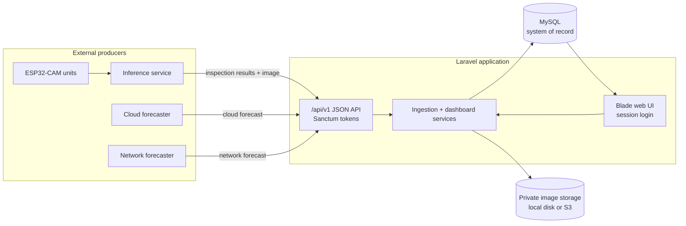

# Documentation

> This folder is the **human handbook** for the Smart Garment Defect Detection backend. It explains
> what the system does, how to run it, how its parts fit together, and what to do when something
> breaks. Start here, then follow the path that matches what you need to do.

**Who this is for:** new developers, backend contributors, the inference and forecasting teams that
send us data, and whoever deploys or operates the system.

**What you'll find:** a five-minute orientation, a glossary so the vocabulary is unambiguous, reading
paths, and one page per topic. The companion [`../ai-docs/`](../ai-docs/01-project-overview.md)
folder is the *specification* — exact classes, columns, and invariants. This folder teaches;
`ai-docs/` specifies.

---

## The short version

1. This is a **Laravel 12 monitoring backend**. It stores inspection results from ESP32-CAM units and
   resource forecasts from cloud/network services, then shows them in a Blade dashboard and a JSON API.
2. It does **not** run machine learning. The inference service and the forecasters are external; this
   app validates, stores, and presents what they send.
3. There are two front doors: a **session-authenticated web UI** for people, and a
   **Sanctum-token API** (`/api/v1`) for machines.
4. **MySQL** is the system of record. Inspection images live on a **private disk** (local or S3).
5. Repeated submissions are **rejected, not overwritten**. A duplicate inspection or forecast returns
   HTTP `409`, which a producer should treat as "already stored".

## How the pieces fit

One sentence that covers the whole system: **a camera takes a photo, the inference service decides
PASS or DEFECT, this backend stores that decision with its evidence, and the dashboard turns the
stored rows into trends, device health, and forecast warnings.**

---

## Choose your path

| I am… | Read in this order | Why |
| --- | --- | --- |
| **New to the project** | this page → [architecture](architecture.md) → [local-setup](local-setup.md) | Understand the shape first, then get it running |
| **A backend developer** | [architecture](architecture.md) → [database](database.md) → [api](api.md) → [integration-contracts](integration-contracts.md) | Follow a request from route to database and back |
| **Building a producer** (inference or forecaster) | [integration-contracts](integration-contracts.md) → [api](api.md) → [troubleshooting](troubleshooting.md) | Start with the rules you must satisfy, then the exact HTTP shapes |
| **Deploying or operating it** | [environment](environment.md) → [deployment](deployment.md) → [aws-oidc](aws-oidc.md) | Configure, ship, and connect GitHub to AWS |
| **Running a demo or doing QA** | [local-setup](local-setup.md) → [architecture](architecture.md) | Seeded accounts, demo data, and what you should see on screen |
| **Stuck on an error** | [troubleshooting](troubleshooting.md) | Symptom → cause → fix, with links to the owning page |

## Five-minute orientation

| Moving part | What it is | Where it lives |
| --- | --- | --- |
| **Web UI** | Dashboard, inspection history, device management, forecast charts, users, settings | `resources/views/`, routes in `routes/web.php` |
| **JSON API** | Nine endpoints under `/api/v1` for ingestion, reads, and health | `routes/api.php`, controllers in `app/Http/Controllers/Api/V1/` |
| **Domain logic** | Transactions, duplicate handling, supersede rules, dashboard aggregation | `app/Services/` |
| **Database** | Users, devices, inspections, detections, forecasts, predictions | MySQL, migrations in `database/migrations/` |
| **Image storage** | Private inspection images with short-lived signed URLs | `app/Services/ImageStorageService.php` |

Two rules explain most of the behaviour you will see:

- **Evidence is append-only.** There is no update or delete endpoint for inspections. A duplicate
  `inspection_id` is rejected so a retry cannot rewrite history.
- **Forecasts supersede per source.** A new cloud forecast marks the previous cloud forecast
  `SUPERSEDED`; network forecasts are untouched. Exactly one forecast per source is `ACTIVE`.

## Domain glossary

| Term | Meaning |
| --- | --- |
| **Inspection** | One accepted result from one camera at one moment: PASS or DEFECT, plus metadata and optional image. |
| **Detection** | One defect found inside an inspection (class, confidence, optional bounding box). A PASS has none. |
| **`inspection_id`** | Producer-generated UUID that identifies an inspection forever. It is the idempotency key. |
| **`defect_count`** | Must equal the number of detections. Enforced twice: at validation and in the service. |
| **PASS / DEFECT** | PASS means zero detections; DEFECT means one or more. There is no "unknown" status. |
| **`device_code`** | The stable external name of a camera (for example `DEVICE-001`). Devices must be registered before use. |
| **Device online** | `status = ACTIVE` **and** `last_seen_at` within `INSPECTION_ONLINE_THRESHOLD_MINUTES` (default 15). Not a stored flag. |
| **Forecast** | One submission from a forecasting service, for one source (`CLOUD` or `NETWORK`). |
| **Prediction** | One value for one metric at one timestamp inside a forecast. |
| **Superseded** | The previous `ACTIVE` forecast for the same source, kept as history. |
| **Warning** | A prediction whose `risk_level` is `HIGH` or `CRITICAL`. |
| **Service account** | A `SERVICE` user that cannot log in to the web UI and exists only to own API tokens. |
| **Ability** | A permission on an API token: `inspections:write`, `forecasts:cloud:write`, `forecasts:network:write`, `read`. |
| **Request ID** | ULID echoed in `X-Request-Id` and every JSON body, useful when reporting a problem. |
| **Signed URL** | A time-limited image link (10 minutes). Treat it as sensitive; anyone holding it can fetch the image. |
| **Backfill window** | How far in the past an inspection may be dated (default 7 days). Older results are rejected. |
| **Display timezone** | `APP_DISPLAY_TIMEZONE` controls rendering only. Storage is always UTC. |

## Documentation map

| Page | What it answers |
| --- | --- |
| [architecture.md](architecture.md) | What are the components, how does a request flow, and what does the app deliberately not do? |
| [local-setup.md](local-setup.md) | How do I get it running locally, seed data, and verify it works? |
| [database.md](database.md) | What tables exist, how do they relate, and which SQL answers real questions? |
| [api.md](api.md) | How do I authenticate, call each endpoint, and interpret responses? |
| [integration-contracts.md](integration-contracts.md) | What must a producer do to be accepted, and how should it retry? |
| [environment.md](environment.md) | Which variable controls what, and which ones must I set? |
| [deployment.md](deployment.md) | How do I build the image, run Compose, and deploy to ECS? |
| [aws-oidc.md](aws-oidc.md) | How do I let GitHub Actions deploy without long-lived AWS keys? |
| [troubleshooting.md](troubleshooting.md) | I have this error — what does it mean and how do I fix it? |

## Human docs vs AI docs

| Folder | Audience | Style | Source of truth for |
| --- | --- | --- | --- |
| `docs/` (this folder) | People | Narrative, walkthroughs, checkpoints, glossary | Tasks and understanding |
| [`ai-docs/`](../ai-docs/01-project-overview.md) | AI coding agents and maintainers | Tables, class names, invariants, exact fields | Implementation detail |

When the two disagree, the code wins. Update both when behaviour changes — see
[`../AGENTS.md`](../AGENTS.md).

## Conventions used in these pages

- **Commands** are shown for a POSIX shell (Git Bash, WSL, macOS, Linux). Windows equivalents are
  included where the difference matters. Run everything from the project root.
- **Placeholders** look like `$APP_URL`, `$TOKEN`, `<ACCOUNT_ID>`. Replace them; never paste real
  credentials into a document.
- **Checkpoints** say what success looks like. If you don't see it, jump to
  [troubleshooting](troubleshooting.md).
- **Timestamps** are stored in UTC and rendered in `APP_DISPLAY_TIMEZONE`. Never assume the database
  holds local time.
- **Status labels:** `Not Implemented` means the feature does not exist despite files that may
  suggest otherwise; `Needs Verification` means it could not be confirmed in this environment.

## Related

- Project overview and status: [`../ai-docs/01-project-overview.md`](../ai-docs/01-project-overview.md)
- Agent rules for changing code: [`../AGENTS.md`](../AGENTS.md)
- The root quick start: [`../README.md`](../README.md)
