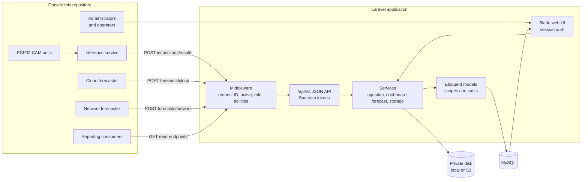
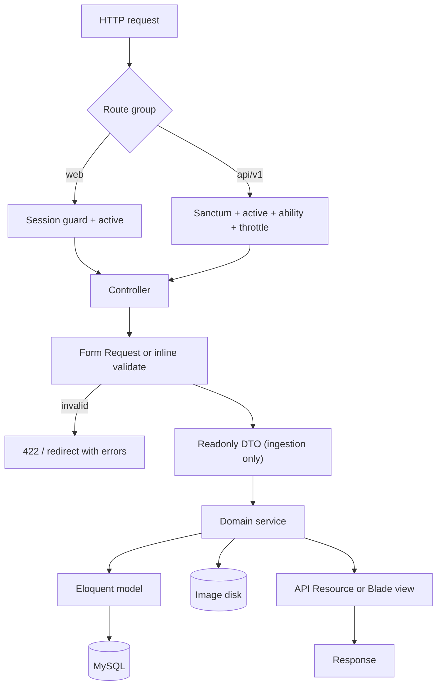
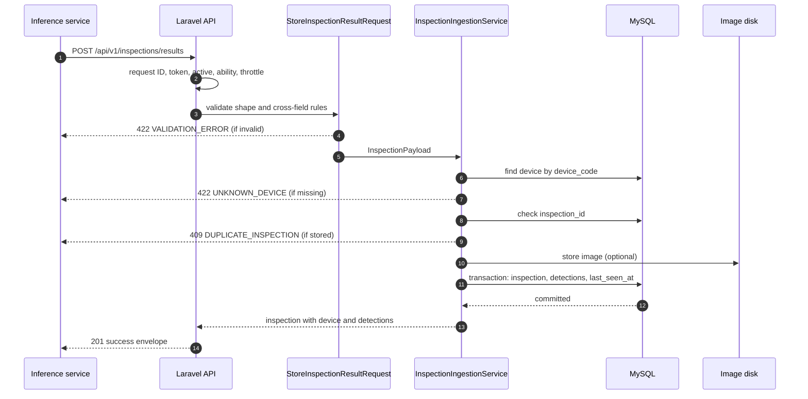

# Architecture

> A single Laravel application with two front doors — a Blade dashboard for people and a JSON API for
> machines — backed by MySQL and a private image store. It is the monitoring tier: it never runs the
> defect-detection model or the forecasting models.

**Who this is for:** developers who need the mental model before changing code.
**What you'll learn:** what the components are, how a request travels through them, why ingestion is
transactional and idempotent, and what the app deliberately does not do.

---

## The short version

1. **One deployable unit.** Nginx, PHP-FPM, and Supervisor in one container; it serves both the UI and
   `/api/v1`.
2. **Two authentication paths.** Session cookies for staff, Sanctum bearer tokens with abilities for
   machines. Both use the same `users` table.
3. **Thin controllers, fat services.** Validation lives in Form Requests, invariants and transactions
   live in `app/Services/`, and responses are built by Resources or Blade views.
4. **MySQL is the system of record.** Images are the only files; they live on a private disk and are
   served through short-lived signed URLs or an authorised UI route.
5. **Ingestion is append-only and idempotent.** A repeated UUID returns `409`, not an overwrite.

## How it works

### System context



There are **no outbound HTTP calls** in application code. Integration is inbound only; the app never
calls the inference service or the forecasters back.

### The story: from photo to dashboard row

1. A camera captures fabric and hands the image to the **inference service**, which is outside this
   repository.
2. The inference service decides PASS or DEFECT, builds a JSON result, and posts it to
   `/api/v1/inspections/results` with a token holding `inspections:write`.
3. Middleware assigns a request ID, authenticates the token, checks the owning account is active, and
   applies the ability and rate limit.
4. `StoreInspectionResultRequest` validates the payload and its cross-field rules. `InspectionPayload`
   turns the validated array into an immutable DTO.
5. `InspectionIngestionService` resolves the device, checks the UUID, and writes the inspection, its
   detections, the optional image, and `device.last_seen_at` inside one transaction.
6. The dashboard later queries those rows through `DashboardMetricsService`, and the API serialises
   them through `InspectionResource`. Nothing is synthesised: if a detection was not submitted, no
   chart invents it.

### Request lifecycle



| Layer | Location | Job |
| --- | --- | --- |
| Routes | `routes/web.php`, `routes/api.php`, `routes/auth.php` | Group middleware and name endpoints |
| Middleware | `app/Http/Middleware/`, `bootstrap/app.php` | Request ID, active account, role, abilities, exceptions |
| Validation | `app/Http/Requests/` | Shape, types, ranges, cross-field consistency |
| Controllers | `app/Http/Controllers/` | Authorise, delegate, format. No business rules |
| DTOs | `app/Data/` | Immutable inbound payloads with `fromArray()` |
| Services | `app/Services/` | Transactions, idempotency, supersede, aggregation, storage |
| Models | `app/Models/` | Relationships, casts, query scopes, small derived values |
| Output | `app/Http/Resources/`, `resources/views/` | JSON serialisation or HTML |

### Who can do what

| Surface | Guard | Extra checks |
| --- | --- | --- |
| `/login` | `guest` | Rate-limited, rejects inactive and `SERVICE` accounts |
| `/dashboard`, `/inspections*`, `/devices*`, `/forecasts*`, `/profile` | session + `active` | Policies for model access |
| `/users*`, `/settings*` | session + `active` + `role:ADMINISTRATOR` | Policies and last-administrator guard |
| `/api/v1/health` | none | `throttle:health` |
| `/api/v1/*` (everything else) | `auth:sanctum` + `active` | `abilities:<ability>` and a throttle |

Service accounts are deliberately excluded from the web UI: login rejects them, user management hides
them, and their only purpose is to own tokens.

### Runtime components

| Component | Responsibility |
| --- | --- |
| Nginx | Listens on port 80, serves the app, forwards PHP to PHP-FPM. TLS is terminated by the load balancer |
| PHP-FPM 8.3 | Executes Laravel in the production image |
| Supervisor | Runs and restarts Nginx and PHP-FPM inside the container |
| MySQL | Durable record of users, devices, inspections, detections, forecasts, predictions |
| Object storage | Private inspection images: local `storage/app/private` or S3-compatible |
| Queue and scheduler | **Not used.** No jobs are dispatched and no scheduled tasks are registered |

## Step by step: follow one inspection



What each stage guarantees:

| Stage | Guarantee |
| --- | --- |
| Middleware | The caller is a live, active service account with the right ability |
| Form Request | Required fields exist, types and ranges are sane, `defect_count` matches detections, status matches the count, timestamps are inside the backfill/future window |
| Service re-check | The invariant holds even for callers that bypass HTTP (tests, future commands) |
| Device lookup | Unknown codes fail with `422 UNKNOWN_DEVICE` instead of creating orphan rows |
| Duplicate check | A retry cannot overwrite evidence; the unique index is the final guard |
| Transaction | A failed detection insert rolls back the parent inspection |
| Image cleanup | If the transaction fails after an image was written, the object is deleted |

`received_at` is set by the server; `inspected_at` comes from the producer. That separation is what
lets you tell "the camera saw this at 10:00" from "we stored it at 10:04".

### Follow one forecast

1. A forecaster posts a UUID, model metadata, a horizon, and 1–500 predictions to `/forecasts/cloud`
   or `/forecasts/network`.
2. Validation enforces lower-snake-case metric names, numeric values, risk enums, no duplicate
   `(metric_name, predicted_at)` pairs, and a `generated_at` no more than 5 minutes in the future.
3. `ForecastIngestionService` rejects a duplicate `(source_type, external_id)` with `409`.
4. In one transaction it marks the previous `ACTIVE` forecast **of that source** as `SUPERSEDED`,
   inserts the new forecast as `ACTIVE`, and inserts every prediction.
5. History is kept. The dashboard and read API show the newest `ACTIVE` forecast per source and can
   list older ones.

Superseding is per source: a network forecast never touches cloud forecasts. `EXPIRED` exists in the
enum and schema but **no code sets it** — see [database.md](database.md#forecasts).

### Dashboard data

| Panel | Source |
| --- | --- |
| KPI cards | `DashboardMetricsService::summary()` — totals, pass, defect, defect rate, today, last 24h |
| 14-day trend | Daily buckets by status, including zero-value days |
| Defect mix | Top defect classes by detection count |
| Recent inspections | Latest rows with device and detections |
| Device health | Status counts plus the online rule |
| Forecast panels | Newest `ACTIVE` forecast per source, charted from stored predictions |
| Warnings | `HIGH`/`CRITICAL` predictions on active forecasts |

Charts are rendered server-side into inline configuration and drawn by `renderChart()` in
`resources/js/app.js`. There is no polling, WebSocket, or client-side data fetching.

## Reference

### Services and what belongs where

| Service | Owns |
| --- | --- |
| `InspectionIngestionService` | Device resolution, duplicate rejection, transaction, image persistence, cleanup, `last_seen_at` |
| `ForecastIngestionService` | Duplicate rejection, source-scoped supersede, forecast and prediction insert |
| `ForecastPresentationService` | Chart series, metric labels, warning lists |
| `DashboardMetricsService` | KPI and trend queries, device overview, recent rows, forecast summary |
| `ImageStorageService` | Disk selection, server-generated filenames, 10-minute URLs, deletion |

If you are tempted to put a transaction or an invariant in a controller, it almost certainly belongs in
one of these services.

### Enumerations

| Enum | Values |
| --- | --- |
| `Role` | `ADMINISTRATOR`, `OPERATOR`, `SERVICE` |
| `DeviceStatus` | `ACTIVE`, `INACTIVE`, `MAINTENANCE` |
| `InspectionStatus` | `PASS`, `DEFECT` |
| `ForecastSource` | `CLOUD`, `NETWORK` |
| `ForecastStatus` | `ACTIVE`, `SUPERSEDED`, `EXPIRED` |
| `RiskLevel` | `LOW`, `MEDIUM`, `HIGH`, `CRITICAL` |

Enums are cast by Eloquent and carry display helpers (`label()`, `color()`). Comparisons use enum
cases, not raw strings.

### API response shape

Every API response uses one envelope, assigned a request ID that is also returned in `X-Request-Id`:

```json
{
  "success": true,
  "data": {},
  "request_id": "01J...",
  "meta": {}
}
```

Errors carry a stable code (`DUPLICATE_INSPECTION`, `UNKNOWN_DEVICE`, `VALIDATION_ERROR`, …). The full
list and the per-endpoint rules are in [api.md](api.md#response-envelope); do not invent a second
envelope.

### What this app deliberately does not do

- Run inference, load models, or analyse images.
- Manage ESP32 firmware or device provisioning.
- Allow public self-registration, password reset, or email verification (**Not Implemented** even
  though Breeze controllers and views exist on disk).
- Stream updates in real time; pages render from the database per request.
- Isolate tenants or plants; one deployment serves one organisation.
- Delete inspections. Evidence is append-only, and a device with inspections cannot be hard-deleted.

## Common problems

| What you notice | Where the cause usually is |
| --- | --- |
| Dashboard is empty but the API returns rows | Aggregation or time window — check `DashboardMetricsService` and the clock |
| A device never shows online | It must be `ACTIVE` **and** have a recent `last_seen_at`; only successful ingestion updates it |
| Two forecasts are `ACTIVE` for one source | Supersede is not concurrency-safe; see the note in [database.md](database.md) |
| An API error has an unexpected shape | Exception rendering in `bootstrap/app.php` |
| Images open for a moment then expire | Signed URLs live for 10 minutes by design |
| A queued job never runs | There is no worker and no dispatched job — queues are not part of this system |

## Related

- Schema and queries: [database.md](database.md)
- Endpoint mechanics: [api.md](api.md)
- Producer rules: [integration-contracts.md](integration-contracts.md)
- Implementation-level detail: [`../ai-docs/03-system-architecture.md`](../ai-docs/03-system-architecture.md)
