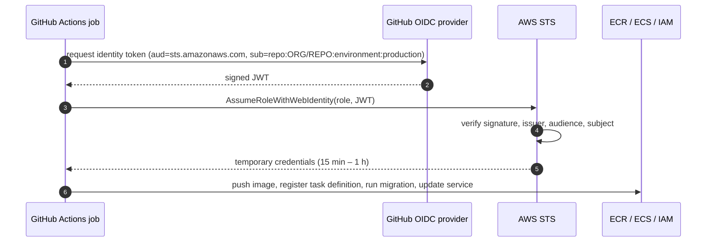

# GitHub Actions → AWS with OIDC

> Let the deploy workflow assume an IAM role without storing any long-lived AWS access key in GitHub.
> GitHub signs a short-lived identity token, AWS verifies it, and the workflow receives temporary
> credentials scoped to one role.

**Who this is for:** whoever configures CI/CD for the repository.
**What you'll learn:** how the trust works, the exact provider, role, trust policy, permission policy,
and repository settings, and how to verify or revoke it.
**Important:** this is a **template**. No AWS account was configured from this repository. Treat every
command as a one-time setup step to run in an approved account, and verify the outcome yourself.

---

## The short version

1. **One OIDC provider per AWS account** for `token.actions.githubusercontent.com`.
2. **One role**, `garment-defect-deploy`, trusted only for `repo:ORG/REPO:environment:production`.
3. **One GitHub secret**, `AWS_DEPLOY_ROLE_ARN`, and **five required variables** (`AWS_REGION`,
   `ECR_REPOSITORY`, `ECS_CLUSTER`, `ECS_SERVICE`, `ECS_TASK_FAMILY`).
4. **No access keys.** The workflow requests `id-token: write` and exchanges it for temporary
   credentials.
5. **Revoke by editing the trust policy** or deleting the role — there is no key to rotate.

## How it works



Three claims decide whether the exchange succeeds:

| Claim | Expected value | Why |
| --- | --- | --- |
| `aud` | `sts.amazonaws.com` | The token is meant for AWS |
| `sub` | `repo:ORG/REPO:environment:production` | Only this repository, only the `production` environment |
| `iss` | `https://token.actions.githubusercontent.com` | The provider URL must match exactly |

The deploy job declares `environment: production`, which is why the subject carries the environment
segment. A pull request or a tag job without that environment produces a different `sub` and is
rejected. That is the point: the role cannot be assumed from an arbitrary branch.

## Step by step

### 1. Create the OIDC provider (once per account)

```bash
aws iam create-open-id-connect-provider \
  --url https://token.actions.githubusercontent.com \
  --client-id-list sts.amazonaws.com \
  --thumbprint-list 6938fd4d98bab03faadb97b34396831e3780aea1
```

If AWS rejects the thumbprint — it can change, and some partitions no longer require one — create the
provider in the IAM console with **Provider URL** `https://token.actions.githubusercontent.com` and
**Audience** `sts.amazonaws.com`, and leave the thumbprint empty.

**Checkpoint:** `aws iam list-open-id-connect-providers` shows the provider ARN ending in
`oidc-provider/token.actions.githubusercontent.com`.

### 2. Write the trust policy

Save as `trust-policy.json`, replacing `ORG/REPO` and `<ACCOUNT_ID>`:

```json
{
  "Version": "2012-10-17",
  "Statement": [
    {
      "Effect": "Allow",
      "Principal": {
        "Federated": "arn:aws:iam::<ACCOUNT_ID>:oidc-provider/token.actions.githubusercontent.com"
      },
      "Action": "sts:AssumeRoleWithWebIdentity",
      "Condition": {
        "StringEquals": {
          "token.actions.githubusercontent.com:aud": "sts.amazonaws.com",
          "token.actions.githubusercontent.com:sub": "repo:ORG/REPO:environment:production"
        }
      }
    }
  ]
}
```

Do **not** loosen `sub` to a wildcard such as `repo:ORG/REPO:*` unless you accept that any branch can
deploy to production. If you do need tag- or branch-scoped deploys, use an explicit `StringLike` with a
narrow pattern and separate roles per environment.

### 3. Create the role

```bash
aws iam create-role \
  --role-name garment-defect-deploy \
  --assume-role-policy-document file://trust-policy.json
```

**Checkpoint:** the command returns an ARN. Put that value in GitHub as `AWS_DEPLOY_ROLE_ARN` (step 5).

### 4. Attach the permission policy

The role needs to push an image, register a task revision, run a one-off migration task, update the
service, read deploy logs, and pass the two container roles to ECS.

```json
{
  "Version": "2012-10-17",
  "Statement": [
    {
      "Sid": "EcrLogin",
      "Effect": "Allow",
      "Action": ["ecr:GetAuthorizationToken"],
      "Resource": "*"
    },
    {
      "Sid": "EcrPush",
      "Effect": "Allow",
      "Action": [
        "ecr:BatchCheckLayerAvailability",
        "ecr:GetDownloadUrlForLayer",
        "ecr:BatchGetImage",
        "ecr:InitiateLayerUpload",
        "ecr:UploadLayerPart",
        "ecr:CompleteLayerUpload",
        "ecr:PutImage",
        "ecr:DescribeImages",
        "ecr:DescribeRepositories"
      ],
      "Resource": "arn:aws:ecr:<REGION>:<ACCOUNT_ID>:repository/garment-defect"
    },
    {
      "Sid": "EcsDeploy",
      "Effect": "Allow",
      "Action": [
        "ecs:DescribeTaskDefinition",
        "ecs:RegisterTaskDefinition",
        "ecs:RunTask",
        "ecs:DescribeTasks",
        "ecs:DescribeServices",
        "ecs:UpdateService"
      ],
      "Resource": "*"
    },
    {
      "Sid": "PassTaskRoles",
      "Effect": "Allow",
      "Action": "iam:PassRole",
      "Resource": [
        "arn:aws:iam::<ACCOUNT_ID>:role/garment-defect-execution",
        "arn:aws:iam::<ACCOUNT_ID>:role/garment-defect-task"
      ],
      "Condition": {
        "StringEquals": {
          "iam:PassedToService": "ecs-tasks.amazonaws.com"
        }
      }
    },
    {
      "Sid": "ReadDeployLogs",
      "Effect": "Allow",
      "Action": [
        "logs:DescribeLogStreams",
        "logs:GetLogEvents",
        "logs:FilterLogEvents"
      ],
      "Resource": "arn:aws:logs:<REGION>:<ACCOUNT_ID>:log-group:/ecs/garment-defect:*"
    }
  ]
}
```

Save as `deploy-policy.json` and attach it:

```bash
aws iam put-role-policy \
  --role-name garment-defect-deploy \
  --policy-name garment-defect-deploy \
  --policy-document file://deploy-policy.json
```

Why `iam:PassRole` is required: registering a task definition that references the execution and task
roles is an implicit pass of those roles. The condition limits the pass to ECS tasks. The two container
roles themselves are described in [deployment.md](deployment.md#3-container-roles).

`ecs:RunTask` and `ecs:DescribeTasks` are used by the one-off migration step. If you never set the
subnet and security-group variables, that step is skipped and those actions are unused — but leaving
them in keeps the two deployment modes consistent.

### 5. Configure the GitHub repository

Create a **production** environment under **Settings → Environments**, with required reviewers if
deployments need approval. The workflow's subject claim depends on that environment name.

Add one secret:

| Kind | Name | Value |
| --- | --- | --- |
| Secret | `AWS_DEPLOY_ROLE_ARN` | `arn:aws:iam::<ACCOUNT_ID>:role/garment-defect-deploy` |

Add the variables the workflow validates:

| Variable | Example | Required |
| --- | --- | --- |
| `AWS_REGION` | `ap-southeast-1` | yes |
| `ECR_REPOSITORY` | `garment-defect` | yes |
| `ECS_CLUSTER` | `garment-defect` | yes |
| `ECS_SERVICE` | `garment-defect` | yes |
| `ECS_TASK_FAMILY` | `garment-defect` | yes |
| `ECS_SUBNET_IDS` | `subnet-aaaa,subnet-bbbb` | optional; enables automatic migrations |
| `ECS_SECURITY_GROUP_IDS` | `sg-cccc` | optional; enables automatic migrations |

With the GitHub CLI:

```bash
gh variable set AWS_REGION --body "ap-southeast-1"
gh variable set ECR_REPOSITORY --body "garment-defect"
gh variable set ECS_CLUSTER --body "garment-defect"
gh variable set ECS_SERVICE --body "garment-defect"
gh variable set ECS_TASK_FAMILY --body "garment-defect"

gh secret set AWS_DEPLOY_ROLE_ARN \
  --body "arn:aws:iam::<ACCOUNT_ID>:role/garment-defect-deploy"
```

The workflow fails fast with an `::error::` annotation if any required variable or the secret is
missing, before it attempts to assume the role.

### 6. Verify

```bash
gh workflow run deploy.yml
gh run list --workflow deploy.yml
gh run watch
```

**Checkpoint:** the run gets past "Configure AWS credentials (OIDC)" and reports a role ARN in the
credentials step. If you only want to test the trust, temporarily dispatch the workflow with an
`image_tag` that exists, or run a throwaway job that calls `aws sts get-caller-identity`.

## Reference

### What the workflow does

`.github/workflows/deploy.yml`:

1. validates the required variables and the `AWS_DEPLOY_ROLE_ARN` secret;
2. assumes the role through `aws-actions/configure-aws-credentials` using OIDC;
3. logs in to ECR and builds/pushes the image tagged with the commit SHA (or the manual input) plus
   `latest`;
4. downloads the current task definition, replaces the image, strips read-only fields, and registers a
   new revision;
5. runs `php artisan migrate --force` as a one-off Fargate task, when the subnet and security-group
   variables are set;
6. updates the service with `--force-new-deployment` and waits for `services-stable`;
7. writes a summary with the image URI and task definition ARN.

The job declares `permissions: id-token: write` and `contents: read`. Without `id-token: write` the
OIDC exchange cannot happen.

### Subject claim variants

| Workflow context | `sub` |
| --- | --- |
| Job with `environment: production` (this workflow) | `repo:ORG/REPO:environment:production` |
| Job on `main` without an environment | `repo:ORG/REPO:ref:refs/heads/main` |
| Pull request | `repo:ORG/REPO:pull_request` |
| Tag push without an environment | `repo:ORG/REPO:ref:refs/tags/v1.0.0` |

If you change the environment name, the job's environment, or the repository name, update the trust
policy at the same time. This is the most common cause of a sudden `AccessDenied`.

### Verification and rotation

- The role has no long-lived credential, so there is nothing to rotate.
- To revoke GitHub's access, delete the role or remove the repository/org from the trust policy.
- Review the role's CloudTrail activity periodically.
- Rotate the container's own secrets separately; they live in Secrets Manager, not here.

### Cleanup order

1. Remove the `AWS_DEPLOY_ROLE_ARN` secret and the deployment variables.
2. Delete the `garment-defect-deploy` role and its inline policy.
3. Delete the OIDC provider if no other role in the account uses it.
4. Revoke producer tokens from the application, then tear down ECS, RDS, S3, and ECR.

Deleting the OIDC provider first breaks every workflow that depends on it, including unrelated
repositories in the same account. Check first.

## Common problems

| Error | Cause | Fix |
| --- | --- | --- |
| `Not authorized to perform sts:AssumeRoleWithWebIdentity` | `sub` or `aud` mismatch | Match the exact `repo:ORG/REPO:environment:production` and `sts.amazonaws.com` |
| `No OpenID Connect provider found` | Provider URL differs, or the provider is in another account | Create it in this account with the exact URL |
| `Credentials could not be loaded` / `id-token` error | Workflow lacks `permissions: id-token: write` | Add the permission at job or workflow level |
| `AccessDenied` on ECR push | Repository ARN mismatch or wrong image name | Fix `<REGION>`/`<ACCOUNT_ID>`/repository in the policy |
| `AccessDenied` on `iam:PassRole` | Execution or task role ARN wrong, or the condition blocks it | Correct the ARNs; keep `iam:PassedToService` |
| `ResourceNotFoundException` on ECS | `ECS_CLUSTER`, `ECS_SERVICE`, or `ECS_TASK_FAMILY` wrong | Fix the repository variables |
| Workflow fails at "Validate deployment configuration" | A required variable or the secret is unset | Set all five variables and `AWS_DEPLOY_ROLE_ARN` |
| Migration step skipped | `ECS_SUBNET_IDS` or `ECS_SECURITY_GROUP_IDS` empty | Set both, or run migrations manually |

Deployment-side symptoms are in [deployment.md](deployment.md#common-problems) and
[troubleshooting.md](troubleshooting.md).

## Fallback: static keys (not recommended)

An IAM user access key stored as a GitHub secret would also work, but it creates a long-lived
credential that must be rotated, audited, and can be exfiltrated from a compromised workflow. Use it
only as a temporary, documented exception, and remove it once OIDC works.

## Related

- Image, ECS service, and migration runbook: [deployment.md](deployment.md)
- Variables the container needs: [environment.md](environment.md)
- Implementation-level CI/CD detail: [`../ai-docs/14-deployment-and-infrastructure.md`](../ai-docs/14-deployment-and-infrastructure.md)
