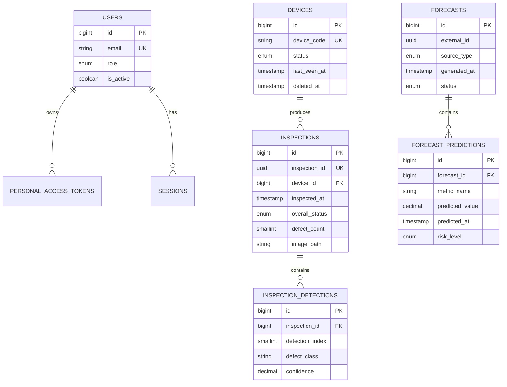

# Database

> MySQL 8 (or MariaDB 10.4+) is the system of record. Six application tables hold users, devices,
> inspections, detections, forecasts, and predictions. Everything is timestamped in UTC and joined by
> numeric IDs, except inspections, which the outside world addresses by UUID.

**Who this is for:** developers writing queries, migrations, or reports.
**What you'll learn:** what each table represents, how the tables relate, which rules the schema does
and does not enforce, and how to answer common reporting questions.

---

## The short version

1. **Devices produce inspections; inspections contain detections.** One inspection has 0 detections
   (PASS) or 1+ (DEFECT).
2. **Inspection identity is two-layered.** A numeric `id` is used for joins; a UUID `inspection_id` is
   the public idempotency key used in URLs and producer retries.
3. **Forecasts contain predictions.** A forecast is one submission from one source (`CLOUD` or
   `NETWORK`); a prediction is one metric value at one timestamp.
4. **Uniqueness does the heavy lifting.** `inspection_id`, `(source_type, external_id)`, and
   `(forecast_id, metric_name, predicted_at)` are unique at the database level.
5. **All timestamps are UTC.** `APP_DISPLAY_TIMEZONE` only affects rendering, never storage.

## How the tables relate



`personal_access_tokens` and `sessions` are framework/Sanctum tables, drawn for completeness.

### Which table answers which question

| Question | Table |
| --- | --- |
| Who can sign in, and with what role? | `users` |
| Which cameras exist and when did each last report? | `devices` |
| How many PASS/DEFECT results today? | `inspections` |
| Which defect classes are most common? | `inspection_detections` |
| What did the cloud/network model predict? | `forecasts` + `forecast_predictions` |
| Which token belongs to which machine account? | `personal_access_tokens` |

## Tables

### `users`

**Represents:** every human and machine identity. Staff sign in with a session; `SERVICE` accounts
only own API tokens.

| Column | Type | Notes |
| --- | --- | --- |
| `id` | bigint unsigned, PK | |
| `name` | varchar(255) | Display name |
| `email` | varchar(255), unique | Login identifier |
| `email_verified_at` | timestamp, nullable | Set by the seeder; verification is not routed |
| `password` | varchar(255) | Bcrypt hash, never returned by the API |
| `role` | enum `ADMINISTRATOR`, `OPERATOR`, `SERVICE` | Default `OPERATOR`, indexed |
| `is_active` | boolean | Default true, indexed |
| `last_login_at` | timestamp, nullable | Updated on successful web login |
| `remember_token` | varchar(100), nullable | Remember-me cookie |
| `created_at`, `updated_at` | timestamps | |

**Relationships:** owns many `personal_access_tokens` and `sessions`.

**Gotchas**
- Deactivation is `is_active = false`; rows are never deleted. The `active` middleware enforces this
  on the next request and signs the user out.
- `SERVICE` accounts are hidden from user management and rejected at login. They are created by the
  seeder, not the UI.
- There is no password-reset route, so `password_reset_tokens` is unused.

### `devices`

**Represents:** a registered inspection camera. A device must exist before its inspections are
accepted.

| Column | Type | Notes |
| --- | --- | --- |
| `id` | bigint unsigned, PK | |
| `device_code` | varchar(50), unique | External identity, e.g. `DEVICE-001` |
| `device_name` | varchar(100) | Human-readable |
| `description` | text, nullable | |
| `location` | varchar(150), nullable | Line, room, or area |
| `status` | enum `ACTIVE`, `INACTIVE`, `MAINTENANCE` | Default `ACTIVE`, indexed |
| `last_seen_at` | timestamp, nullable, indexed | Updated **only** by accepted inspections |
| `created_at`, `updated_at` | timestamps | |
| `deleted_at` | timestamp, nullable | Soft delete |

**Relationships:** has many `inspections`; has one `latestInspection`.

**Gotchas**
- "Online" is computed, not stored: `status = ACTIVE` **and** `last_seen_at` within
  `INSPECTION_ONLINE_THRESHOLD_MINUTES` (default 15). A new device is offline until its first
  inspection.
- Soft deletes are configured but **no route deletes a device**. `DevicePolicy::delete` is unused.
- Inspections use `restrictOnDelete`, so a device with inspections cannot be hard-deleted even by SQL.
- `device_code` is normalised to uppercase by the form request; SQL inserts bypass that rule.

### `inspections`

**Represents:** one accepted result from one camera at one moment.

| Column | Type | Notes |
| --- | --- | --- |
| `id` | bigint unsigned, PK | Internal join key |
| `inspection_id` | uuid, **unique** | Public identity and idempotency key |
| `device_id` | bigint unsigned, FK → `devices.id` | `restrictOnDelete` |
| `inspected_at` | timestamp, indexed | When the camera inspected the fabric |
| `received_at` | timestamp, nullable | When the server stored it |
| `overall_status` | enum `PASS`, `DEFECT` | Indexed |
| `defect_count` | smallint unsigned, default 0 | Must equal the detection count |
| `processing_time_ms` | int unsigned, nullable | Inference latency reported by the producer |
| `model_version` | varchar(50) | Model that produced the result |
| `image_path` | varchar(255), nullable | Relative private path, never a public URL |
| `image_mime` | varchar(50), nullable | |
| `image_size_bytes` | int unsigned, nullable | |
| `metadata` | json, nullable | Producer-defined |
| `created_at`, `updated_at` | timestamps | |

**Indexes:** unique `inspection_id`; `inspected_at`; `overall_status`; `(device_id, inspected_at)`;
`(overall_status, inspected_at)`.

**Relationships:** belongs to `devices`; has many `inspection_detections`.

**Gotchas**
- Routes and API URLs use the **UUID**, not `id` (`Inspection::getRouteKeyName()`).
- `defect_count == count(detections)` and status/count consistency are enforced in code, not by a
  database check constraint. Direct SQL can violate them.
- There is no update or delete endpoint. A duplicate UUID is rejected so retries cannot rewrite
  evidence.
- Images are optional. `image_path` non-null with a missing object is possible after restoring a
  database without the bucket; the UI then returns 404 for the image.

### `inspection_detections`

**Represents:** one defect found inside an inspection. A PASS has no rows here.

| Column | Type | Notes |
| --- | --- | --- |
| `id` | bigint unsigned, PK | |
| `inspection_id` | bigint unsigned, FK → `inspections.id` | `cascadeOnDelete` |
| `detection_index` | smallint unsigned, default 0 | Original order in the submitted array |
| `defect_class` | varchar(50), indexed | Free-form; configured classes are hints |
| `confidence` | decimal(5,4) | 0.0000–1.0000, validated |
| `bbox_x`, `bbox_y` | int unsigned, nullable | Pixel coordinates |
| `bbox_width`, `bbox_height` | int unsigned, nullable | Positive when present |
| `metadata` | json, nullable | |
| `created_at`, `updated_at` | timestamps | |

**Indexes:** `(inspection_id, detection_index)`; `defect_class`.

**Gotchas**
- Bounding boxes are all-or-nothing at the API boundary, but each column is independently nullable.
  `InspectionDetection::boundingBox()` returns `null` unless both width and height are present.
- The API nests the box (`bounding_box: {x, y, width, height}`); the table stores it flat.
- New defect classes are accepted without a migration or deployment.

### `forecasts`

**Represents:** one forecast submission from one source.

| Column | Type | Notes |
| --- | --- | --- |
| `id` | bigint unsigned, PK | |
| `external_id` | uuid | Producer's `forecast_id` |
| `source_type` | enum `CLOUD`, `NETWORK` | Indexed |
| `model_name` | varchar(100) | |
| `model_version` | varchar(50) | |
| `forecast_horizon_minutes` | int unsigned | 1 … `FORECAST_MAX_HORIZON_MINUTES` |
| `generated_at` | timestamp, indexed | Producer generation time |
| `received_at` | timestamp, nullable | Server receipt time |
| `status` | enum `ACTIVE`, `SUPERSEDED`, `EXPIRED` | Default `ACTIVE`, indexed |
| `metadata` | json, nullable | |
| `created_at`, `updated_at` | timestamps | |

**Constraints:** unique `(source_type, external_id)`; index `(source_type, generated_at)`;
index `(source_type, status, generated_at)`.

**Relationships:** has many `forecast_predictions`.

**Gotchas**
- Uniqueness is **per source**: the same UUID may exist once as `CLOUD` and once as `NETWORK`.
- A new accepted forecast marks the previous `ACTIVE` row for that source `SUPERSEDED` inside the
  same transaction. History is retained.
- "Exactly one `ACTIVE` forecast per source" is application logic, not a database constraint.
  Concurrent ingestions can theoretically produce two active rows; read paths take the newest.
- Supersede does not compare `generated_at`, so an older forecast submitted later still supersedes.
- `EXPIRED` is never assigned by code today.

### `forecast_predictions`

**Represents:** one predicted value for one metric at one timestamp.

| Column | Type | Notes |
| --- | --- | --- |
| `id` | bigint unsigned, PK | |
| `forecast_id` | bigint unsigned, FK → `forecasts.id` | `cascadeOnDelete` |
| `metric_name` | varchar(50) | Lower snake case, e.g. `cpu_utilization` |
| `metric_unit` | varchar(20), nullable | `%`, `Mbps`, `ms`, … |
| `predicted_value` | decimal(20,6) | |
| `actual_value` | decimal(20,6), nullable | Observed value, when known |
| `predicted_at` | timestamp | Target timestamp |
| `anomaly_risk` | decimal(5,4), nullable | 0–1, validated |
| `risk_level` | enum `LOW`, `MEDIUM`, `HIGH`, `CRITICAL`, nullable | Indexed |
| `metadata` | json, nullable | |
| `created_at`, `updated_at` | timestamps | |

**Constraints:** unique `(forecast_id, metric_name, predicted_at)` named
`forecast_predictions_metric_unique`; index `(metric_name, predicted_at)` for chart queries.

**Gotchas**
- The unique key prevents duplicate points *inside one forecast*. Two different forecasts may predict
  the same metric at the same time; that is how history works.
- Metric names are not restricted to the catalogue in `config/forecast.php`. Unknown names are stored
  and displayed with a humanised label.
- Only metrics with stored predictions are charted. The UI never interpolates or fills gaps.

### Framework tables

| Table | Used? | Notes |
| --- | --- | --- |
| `personal_access_tokens` | Yes | Sanctum tokens; only hashes stored |
| `sessions` | Yes when `SESSION_DRIVER=database` | Default in `.env.example` |
| `cache`, `cache_locks` | Yes when `CACHE_STORE=database` | Default in `.env.example` |
| `password_reset_tokens` | No | No reset route exists |
| `jobs`, `job_batches`, `failed_jobs` | No | No jobs are dispatched |
| `migrations` | Yes | Migration bookkeeping |

## UUIDs, IDs, and UTC

**Why two identifiers for inspections?** The producer creates the UUID before its first attempt and
reuses it on every retry. That makes ingestion idempotent without asking the producer to remember a
server-assigned number. The numeric `id` stays internal for compact foreign keys and joins. Public
URLs use the UUID because sequential IDs would leak volume and invite enumeration.

| Thing | Identifier used in URLs |
| --- | --- |
| Inspection | `inspection_id` UUID |
| Device | numeric `id` |
| Forecast | numeric `id` |
| User | numeric `id` |

**UTC everywhere.** `config/app.php` sets `timezone` to `UTC`. `display_datetime()` and
`display_date()` convert to `APP_DISPLAY_TIMEZONE` at render time. When writing SQL by hand, compare
against `UTC_TIMESTAMP()`, not `NOW()` on a server configured for another zone. The database session
timezone is not changed by the app, so prefer storing/reading UTC explicitly.

## Data integrity rules

Some rules are in the schema, others only in code. Know which is which before writing SQL.

| Rule | Enforced by |
| --- | --- |
| `inspection_id` is unique | Unique index **and** service pre-check |
| `(source_type, external_id)` is unique | Unique index **and** service pre-check |
| `(forecast_id, metric_name, predicted_at)` is unique | Unique index **and** request validation |
| `defect_count == count(detections)` | Form Request + DTO + service (no DB constraint) |
| PASS has 0 detections, DEFECT has ≥1 | Form Request + DTO + service |
| `inspected_at` within backfill/future window | Form Request |
| `confidence`, `anomaly_risk` within 0–1 | Request validation + decimal precision (no check constraint) |
| One `ACTIVE` forecast per source | Application logic only |
| At least one active administrator remains | `UserController` guard |

Practical consequence: a manual `INSERT` can create a DEFECT with zero detections or two active
forecasts. Use the API or the service layer when correctness matters.

## Common queries

Run these in `mysql`, TablePlus, or `php artisan tinker` (wrap in `DB::select()`). All use UTC.

**1. Pass/defect counts for the last 7 days**

```sql
SELECT overall_status, COUNT(*) AS inspections
FROM inspections
WHERE inspected_at >= UTC_TIMESTAMP() - INTERVAL 7 DAY
GROUP BY overall_status;
```

**2. Defect rate per device over 30 days**

```sql
SELECT d.device_code,
       d.device_name,
       COUNT(i.id) AS inspections,
       SUM(i.overall_status = 'DEFECT') AS defects,
       ROUND(SUM(i.overall_status = 'DEFECT') / COUNT(i.id) * 100, 1) AS defect_rate_pct
FROM devices d
JOIN inspections i ON i.device_id = d.id
WHERE i.inspected_at >= UTC_TIMESTAMP() - INTERVAL 30 DAY
GROUP BY d.id, d.device_code, d.device_name
ORDER BY defect_rate_pct DESC;
```

**3. Most common defect classes**

```sql
SELECT defect_class,
       COUNT(*) AS detections,
       ROUND(AVG(confidence), 3) AS avg_confidence
FROM inspection_detections
GROUP BY defect_class
ORDER BY detections DESC
LIMIT 10;
```

**4. Devices that are offline right now**

```sql
SELECT device_code, device_name, status, last_seen_at
FROM devices
WHERE deleted_at IS NULL
  AND (
        status <> 'ACTIVE'
        OR last_seen_at IS NULL
        OR last_seen_at < UTC_TIMESTAMP() - INTERVAL 15 MINUTE
      )
ORDER BY last_seen_at ASC;
```

Adjust `15` to match `INSPECTION_ONLINE_THRESHOLD_MINUTES`.

**5. Active forecast per source, with prediction and warning counts**

```sql
SELECT f.source_type,
       f.external_id,
       f.model_name,
       f.generated_at,
       COUNT(p.id) AS predictions,
       SUM(p.risk_level IN ('HIGH', 'CRITICAL')) AS warnings
FROM forecasts f
LEFT JOIN forecast_predictions p ON p.forecast_id = f.id
WHERE f.status = 'ACTIVE'
GROUP BY f.id, f.source_type, f.external_id, f.model_name, f.generated_at;
```

**6. Hourly inspection throughput for the last 24 hours**

```sql
SELECT DATE_FORMAT(inspected_at, '%Y-%m-%d %H:00') AS hour_bucket,
       COUNT(*) AS inspections,
       SUM(overall_status = 'DEFECT') AS defects
FROM inspections
WHERE inspected_at >= UTC_TIMESTAMP() - INTERVAL 24 HOUR
GROUP BY hour_bucket
ORDER BY hour_bucket;
```

**7. Look up one inspection by its public UUID**

```sql
SELECT i.inspection_id,
       d.device_code,
       i.inspected_at,
       i.overall_status,
       i.defect_count,
       i.image_path
FROM inspections i
JOIN devices d ON d.id = i.device_id
WHERE i.inspection_id = 'a3baacb9-527b-4ab5-adeb-0b7c4e2b775c';
```

## Migrations

| Migration | Creates |
| --- | --- |
| `0001_01_01_000000_create_users_table` | `users`, `password_reset_tokens`, `sessions` |
| `0001_01_01_000001_create_cache_table` | `cache`, `cache_locks` |
| `0001_01_01_000002_create_jobs_table` | `jobs`, `job_batches`, `failed_jobs` |
| `2026_11_16_044032_create_personal_access_tokens_table` | Sanctum tokens |
| `2026_11_16_050000_create_garment_monitoring_tables` | Devices, inspections, detections, forecasts, predictions |

```bash
php artisan migrate            # apply pending migrations
php artisan migrate:status     # what has run
php artisan migrate:fresh --seed  # local rebuild only
```

In production, run `php artisan migrate --force` as a **single one-off task** before rolling out a new
revision. Do not run migrations on every replica.

### Adding a column safely

1. Add a **new** migration with both `up()` and `down()`. Never edit an applied migration.
2. Update `$fillable` and `casts()` on the model, plus any factory.
3. Update the Form Request, API Resource, Blade view, filters, and tests that touch the column.
4. Add an index if the column will be filtered or joined on, and say why.
5. Update this page and [`../ai-docs/05-database-design.md`](../ai-docs/05-database-design.md).

## Retention and deletion

- Inspections and detections are append-only from the API; there is no update or delete endpoint.
- Deleting a device is blocked while inspections exist; the UI offers deactivation instead.
- Deleting an inspection cascades to its detections; deleting a forecast cascades to its predictions.
- **No retention or purge job exists.** Tables and the image bucket grow indefinitely. If you add
  retention, delete the image object as well as the row — the cascade only covers database rows.
- Back up MySQL and the image bucket **together**. A row with `image_path` but no object is a broken
  image, not a recoverable one.

## Test database

`phpunit.xml` points tests at a separate database:

```text
DB_CONNECTION=mysql
DB_HOST=127.0.0.1
DB_PORT=3306
DB_DATABASE=garment_defect_test
DB_USERNAME=root
DB_PASSWORD=
```

Create it once:

```sql
CREATE DATABASE garment_defect_test CHARACTER SET utf8mb4 COLLATE utf8mb4_unicode_ci;
```

Pest uses `RefreshDatabase`, so the schema is rebuilt for each run; the database must exist, but it
does not need to be migrated beforehand. The suite intentionally uses MySQL rather than SQLite so
enum, JSON, and index behaviour match production.

## Common problems

| Symptom | Cause | Fix |
| --- | --- | --- |
| `Unknown database 'garment_defect_test'` | Test database missing | Create it with the `CREATE DATABASE` above |
| Duplicate row despite a uniqueness rule | The rule is application-only (for example one active forecast) | Fix the writer; do not rely on the schema for that rule |
| `Cannot delete or update a parent row` | Deleting a device that still has inspections | Deactivate the device; inspections are evidence |
| Counts look shifted by hours | Comparing local time against UTC columns | Use `UTC_TIMESTAMP()` and render with `display_datetime()` |
| Dashboard totals differ from SQL | Dashboard uses the app clock and status enum | Compare like-for-like; check `APP_DISPLAY_TIMEZONE` is only for display |
| Soft-deleted device still appears in raw SQL | Eloquent adds `deleted_at IS NULL`; raw SQL does not | Add `WHERE deleted_at IS NULL` |

## Related

- How data gets here: [architecture.md](architecture.md) and [integration-contracts.md](integration-contracts.md)
- Reading it back over HTTP: [api.md](api.md)
- Implementation-level schema detail: [`../ai-docs/05-database-design.md`](../ai-docs/05-database-design.md)
