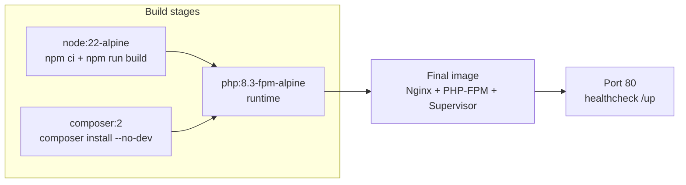
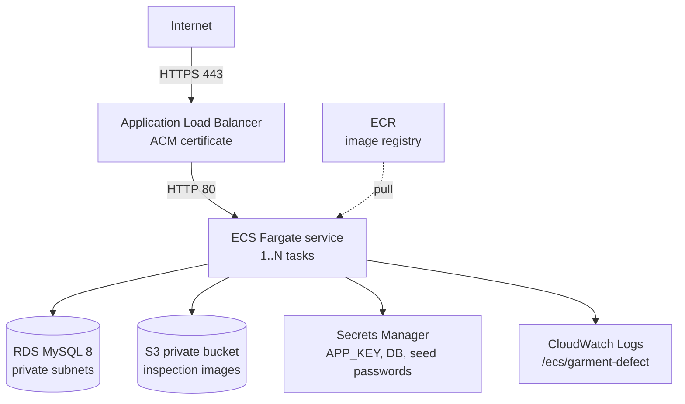

# Deployment

> One application image — Nginx, PHP-FPM 8.3, and Supervisor — runs the dashboard and the API. MySQL
> and image storage are external. The same image runs in Docker Compose for a demo and in ECS/Fargate
> for production.

**Who this is for:** whoever builds, ships, or operates the application.
**What you'll learn:** how the image is built, how to run it locally, what a first ECS deployment
looks like, how migrations and rollbacks work, and which checks matter.
**Heads up:** the AWS section is a **template**. No AWS resources were provisioned from this
repository, and infrastructure-as-code is **Not Implemented**. Treat every AWS command as a runbook
to execute in an approved account, not as a description of something already running.

---

## The short version

1. **Build one image:** `docker build -f docker/Dockerfile -t garment-defect:local .`
2. **Compose for local/demo:** `cp .env.docker.example .env.docker`, replace the `change-me` values,
   `docker compose --env-file .env.docker up --build`, open <http://localhost:8080>.
3. **ECS for production:** ECR image + RDS MySQL + private S3 bucket + Secrets Manager + ALB + Fargate
   service. The task definition template is `docker/ecs-task-definition.json`.
4. **Migrate once, not per replica:** run `php artisan migrate --force` as a one-off task before
   updating the service. The workflow does this when subnet and security-group variables are set.
5. **Health is `/up`.** The dependency-aware probe is `/api/v1/health`.

## How it works

### Image anatomy



The multi-stage build compiles Vite assets, installs production Composer dependencies with an
optimised classmap autoloader, then copies only the compiled assets and the vendor tree into a PHP
8.3-FPM Alpine image with Nginx and Supervisor.

### Runtime topology



TLS terminates at the load balancer. The container only speaks HTTP on port 80, because that is what
the target group health check expects.

### Container startup

`docker/entrypoint.sh` runs before Supervisor, in this order:

1. create writable directories and fix ownership;
2. refuse to start in production without `APP_KEY`;
3. optionally wait for MySQL (`WAIT_FOR_DB`);
4. optionally run migrations (`RUN_MIGRATIONS`);
5. optionally seed (`RUN_SEED`);
6. warm config, route, view, and event caches (`OPTIMIZE`);
7. hand over to Supervisor, which runs PHP-FPM and Nginx.

Each flag defaults to `false` except `OPTIMIZE`. The image's own defaults also include
`APP_ENV=production`, `APP_DEBUG=false`, and `LOG_CHANNEL=stderr` — so a bare `docker run` behaves like
production, even without a task definition.

## Path A — Docker Compose (local or demo)

### 1. Prepare the environment file

```bash
cp .env.docker.example .env.docker
```

Open `.env.docker` and replace **every** `change-me` value. Compose refuses to start without
`DB_PASSWORD`, `DB_ROOT_PASSWORD`, `ADMIN_PASSWORD`, and `OPERATOR_PASSWORD`, because they are declared
with `:?` (required) substitutions.

Set a stable `APP_KEY` rather than letting the container generate an ephemeral one:

```bash
php artisan key:generate --show
```

Paste the result into `.env.docker` as `APP_KEY=base64:...`.

### 2. Start the stack

```bash
docker compose --env-file .env.docker up --build
```

| Service | Role |
| --- | --- |
| `app` | The application image, published on `${APP_PORT:-8080}` |
| `db` | MySQL 8.4 with a persistent `db-data` volume |
| `minio` | Optional S3-compatible storage, only with the overlay |
| `minio-init` | Creates the private bucket once MinIO is healthy |

**Checkpoint:** `docker compose ps` shows `app` and `db` healthy, and <http://localhost:8080> shows the
login page. Sign in with `ADMIN_EMAIL` / `ADMIN_PASSWORD` from `.env.docker`.

### 3. Turn seeding off after the first start

```dotenv
RUN_SEED=false
```

Every restart with `RUN_SEED=true` re-applies the seeded passwords from `.env.docker`, silently
resetting any password changed in the UI. Leave `RUN_MIGRATIONS=true` for a demo; it is harmless with a
single container.

### 4. Optional: S3-compatible storage with MinIO

Uncomment the S3 block in `.env.docker`, then start with the overlay:

```bash
docker compose --env-file .env.docker \
  -f docker-compose.yml -f docker-compose.s3.yml up --build
```

Required overlay values: `FILESYSTEM_DISK=s3`, `INSPECTION_IMAGE_DISK=s3`,
`AWS_ENDPOINT=http://minio:9000`, `AWS_USE_PATH_STYLE_ENDPOINT=true`, `AWS_BUCKET`,
`MINIO_ROOT_USER`, and `MINIO_ROOT_PASSWORD`. The bucket is created with anonymous access disabled.

**Checkpoint:** upload an inspection image and confirm the returned `image_url` opens; MinIO's console
is on <http://localhost:9001>.

> Compose keeps `storage/app` and `storage/logs` in named volumes. Without them, images written to the
> local disk disappear when the container is recreated.

## Path B — AWS ECS/Fargate (template)

The repository does not create AWS resources. The commands below are the intended order of operations
in an approved account.

### 0. Decide the parameters

| Component | Recommendation |
| --- | --- |
| Compute | ECS Fargate, 0.5 vCPU / 1 GB per task to start |
| Database | RDS MySQL 8.0, Multi-AZ for production, private subnets |
| Storage | S3 bucket with Block Public Access and SSE |
| Registry | ECR with image scanning on push |
| Secrets | Secrets Manager, one secret per concern |
| Sessions/cache | `database`, or ElastiCache Redis when scaling out |
| Logs | CloudWatch Logs via the `awslogs` driver |
| TLS | ACM certificate on the ALB; redirect HTTP to HTTPS |
| DNS | Route 53 alias to the ALB |

### 1. Registry, bucket, database, logs

```bash
aws ecr create-repository \
  --repository-name garment-defect \
  --image-scanning-configuration scanOnPush=true \
  --encryption-configuration encryptionType=AES256

BUCKET=garment-defect-inspection-images
aws s3api create-bucket \
  --bucket "$BUCKET" --region "$AWS_REGION" \
  --create-bucket-configuration LocationConstraint="$AWS_REGION"
aws s3api put-public-access-block --bucket "$BUCKET" \
  --public-access-block-configuration \
    BlockPublicAcls=true,IgnorePublicAcls=true,BlockPublicPolicy=true,RestrictPublicBuckets=true
aws s3api put-bucket-encryption --bucket "$BUCKET" \
  --server-side-encryption-configuration \
    '{"Rules":[{"ApplyServerSideEncryptionByDefault":{"SSEAlgorithm":"AES256"}}]}'

aws logs create-log-group --log-group-name /ecs/garment-defect
aws logs put-retention-policy --log-group-name /ecs/garment-defect --retention-in-days 30
```

Create RDS MySQL privately, then:

```sql
CREATE DATABASE garment_defect CHARACTER SET utf8mb4 COLLATE utf8mb4_unicode_ci;
CREATE USER 'garment'@'%' IDENTIFIED BY '<strong-password>';
GRANT ALL PRIVILEGES ON garment_defect.* TO 'garment'@'%';
```

The ECS security group needs outbound access to the RDS security group on 3306. Never expose RDS
publicly.

### 2. Secrets

```bash
aws secretsmanager create-secret --name garment-defect/app-key \
  --secret-string "base64:$(openssl rand -base64 32)"
aws secretsmanager create-secret --name garment-defect/db-password \
  --secret-string '<strong-password>'
aws secretsmanager create-secret --name garment-defect/admin-password \
  --secret-string '<strong-admin-password>'
aws secretsmanager create-secret --name garment-defect/operator-password \
  --secret-string '<strong-operator-password>'
```

Use the resulting ARNs in the task definition's `secrets` array. The application reads them as plain
environment variables at runtime; nothing is written to the image.

### 3. Container roles

Two roles, both trusted by `ecs-tasks.amazonaws.com`:

| Role | Purpose | Policy |
| --- | --- | --- |
| `garment-defect-execution` | Pull from ECR, write logs, read secrets | `AmazonECSTaskExecutionRolePolicy` plus `secretsmanager:GetSecretValue` on the four secrets |
| `garment-defect-task` | The application's own AWS access | `s3:PutObject`, `s3:GetObject`, `s3:DeleteObject` on the bucket objects; `s3:ListBucket` on the bucket |

No static AWS keys are needed in the application. The **deploy** role that GitHub Actions assumes is
separate and covered in [aws-oidc.md](aws-oidc.md).

### 4. Register the task definition

`docker/ecs-task-definition.json` is a template. Replace every placeholder:

| Placeholder | Value |
| --- | --- |
| `<ACCOUNT_ID>` | AWS account ID |
| `<REGION>` | e.g. `ap-southeast-1` |
| `<IMAGE_TAG>` | Commit SHA or release tag |
| `<DOMAIN>` | Public hostname, e.g. `qc.example.com` |
| `<RDS_ENDPOINT>` | RDS writer endpoint |
| `<INSPECTION_BUCKET>` | S3 bucket name |
| `<ADMIN_EMAIL>` | Administrator login for the seed task |

```bash
aws ecs register-task-definition \
  --cli-input-json file://docker/ecs-task-definition.json
```

The template already sets `RUN_MIGRATIONS=false` and `RUN_SEED=false`, so rolling deployments never
race on schema changes. It also sets `WAIT_FOR_DB=true`, so a task waits for RDS instead of crash
looping during a failover.

### 5. Cluster, load balancer, service

Create an ECS cluster, an ALB with an HTTPS listener and an HTTP→HTTPS redirect, a target group on
port 80 with health check path `/up`, and a Fargate service in private subnets. The service security
group allows inbound 80 from the ALB only.

**Checkpoint after the first service start:**

- the service reaches steady state with the desired task count;
- the target group reports the task healthy;
- `https://<DOMAIN>` shows the login page (or an empty database error if you have not migrated yet);
- CloudWatch `/ecs/garment-defect` shows the entrypoint log lines and Supervisor starting both
  programs.

### 6. Migrate, seed, and issue tokens

Run these as **one-off tasks** using the new revision. The deploy workflow automates the migration
step; seeding and token issuance are deliberately manual.

```bash
CLUSTER=garment-defect
TASK_DEF=garment-defect:42
SUBNETS=subnet-aaaa,subnet-bbbb
SECURITY_GROUPS=sg-cccc

TASK_ARN=$(aws ecs run-task \
  --cluster "$CLUSTER" --task-definition "$TASK_DEF" --launch-type FARGATE \
  --network-configuration "awsvpcConfiguration={subnets=[$SUBNETS],securityGroups=[$SECURITY_GROUPS],assignPublicIp=DISABLED}" \
  --overrides '{"containerOverrides":[{"name":"app","command":["php","artisan","migrate","--force","--no-interaction"]}]}' \
  --query 'tasks[0].taskArn' --output text)

aws ecs wait tasks-stopped --cluster "$CLUSTER" --tasks "$TASK_ARN"
aws ecs describe-tasks --cluster "$CLUSTER" --tasks "$TASK_ARN" \
  --query 'tasks[0].containers[0].exitCode'
```

A non-zero exit code means stop. For the first deployment only, repeat the pattern with
`["php","artisan","db:seed","--force","--no-interaction"]`. `APP_ENV=production` aborts seeding if the
administrator password is missing or a known default.

Issue producer tokens inside a running task, because they are written to the database:

```bash
aws ecs execute-command \
  --cluster "$CLUSTER" --task <TASK_ID> --container app --interactive \
  --command "php artisan service:token 'Inference Service' --ability=inspections:write --ability=read"
```

ECS Exec must be enabled on the service. Alternatively run a one-off task with the same command and
read the token from the logs — it is printed once. Store it in the producer's secret manager
immediately.

## CI/CD

| Workflow | Trigger | What it does |
| --- | --- | --- |
| `.github/workflows/ci.yml` | Push to `main`, pull request, manual | MySQL 8.4 service, PHP 8.3 tests, Pint, Vite build, Blade compile, then builds the image and waits for `/up` and `/api/v1/health` |
| `.github/workflows/deploy.yml` | Tag `v*` or manual dispatch | OIDC login, ECR push, task revision registration, one-off migration, service update, wait for stability |

The CI container job is the closest thing to an end-to-end deployment test: it runs the real image
against a real MySQL with `APP_ENV=production`, `RUN_MIGRATIONS=true`, and `WAIT_FOR_DB=true`.

Deploy a release:

```bash
git tag v1.0.0
git push origin v1.0.0
```

The workflow tags the image with the commit SHA (or a manual input) plus `latest`, registers a new task
definition revision with the new image, runs migrations when `ECS_SUBNET_IDS` and
`ECS_SECURITY_GROUP_IDS` are configured, updates the service, and waits for `services-stable`.

Repository settings for the workflow are in [aws-oidc.md](aws-oidc.md).

## Operations

### Health checks

| Probe | Path | Use |
| --- | --- | --- |
| Framework liveness | `/up` | Container `HEALTHCHECK`, ALB target group |
| Dependency health | `/api/v1/health` | Database reachability and the configured storage disk |

Both return `200` when healthy. `/api/v1/health` returns `503` with `"status":"degraded"` when the
database is unreachable. It reports the disk **name** but does not test storage I/O.

### Scaling

- The app is stateless when sessions and cache use the database and images use S3.
- Scale the ECS service horizontally. Do **not** enable `RUN_MIGRATIONS` per task.
- Rate limits are per token owner or IP, not global.
- Ingestion is a short synchronous transaction. If it ever becomes the bottleneck, move forecast
  processing or notifications to a queue and add workers — but no jobs exist today.

### Logs

- Application logs go to stderr, then CloudWatch (`/ecs/garment-defect`).
- Nginx access logs go to stdout; errors to stderr.
- Every API response carries `X-Request-Id`, which is also written to logs. Search CloudWatch for that
  value when debugging a producer report.
- Keep a retention policy (30 days is a reasonable default).

### Rollback

```bash
aws ecs update-service \
  --cluster garment-defect \
  --service garment-defect \
  --task-definition garment-defect:<previous-revision>
```

Migrations are forward-only. If a bad migration shipped, roll forward with a corrective migration;
restoring from a snapshot is a last resort and loses everything written since the snapshot.

### Backups

- Enable automated RDS backups and test point-in-time recovery.
- Enable S3 versioning on the inspection bucket.
- Back up MySQL and S3 **together**; a row with `image_path` but no object is a broken image.
- Record the `APP_KEY` secret version. Losing it invalidates sessions and encrypted values.

## Reference

### Image facts

| Fact | Value |
| --- | --- |
| Base | `php:8.3-fpm-alpine` |
| Web server | Nginx, port 80 |
| Process manager | Supervisor (`nodaemon`) |
| Health check | `curl --fail http://127.0.0.1/up` every 30s, 5s timeout, 20s start period |
| PHP extensions | `pdo_mysql`, `bcmath`, `opcache`, `pcntl` |
| Upload ceiling | Nginx `client_max_body_size 8m`; the app limit is `INSPECTION_IMAGE_MAX_KB` |
| Image defaults | `APP_ENV=production`, `APP_DEBUG=false`, `LOG_CHANNEL=stderr`, `CACHE_STORE=file`, `SESSION_DRIVER=file`, `QUEUE_CONNECTION=sync`, `RUN_MIGRATIONS=false` |

### Run without Compose

```bash
docker run --rm --publish 8080:80 \
  --env APP_ENV=production \
  --env APP_KEY="base64:$(openssl rand -base64 32)" \
  --env APP_DEBUG=false \
  --env APP_URL=http://localhost:8080 \
  --env DB_CONNECTION=mysql \
  --env DB_HOST=host.docker.internal \
  --env DB_DATABASE=garment_defect \
  --env DB_USERNAME=garment \
  --env DB_PASSWORD='...' \
  --env RUN_MIGRATIONS=true \
  --env RUN_SEED=true \
  --env WAIT_FOR_DB=true \
  garment-defect:local
```

Inspect the built image:

```bash
docker run --rm garment-defect:local php artisan --version
docker image inspect garment-defect:local --format '{{.Config.ExposedPorts}}'
```

### Security checklist

- [ ] `APP_ENV=production`, `APP_DEBUG=false`
- [ ] `APP_KEY` injected from Secrets Manager, never committed
- [ ] RDS private, reachable only from the ECS security group
- [ ] S3 bucket private, public access blocked, encryption enabled
- [ ] Task role limited to the inspection bucket
- [ ] Execution role limited to ECR, logs, and the four secrets
- [ ] ALB HTTPS only; HTTP redirects to HTTPS
- [ ] Default administrator password replaced
- [ ] Service tokens scoped per producer and stored outside the repository
- [ ] CloudWatch retention configured
- [ ] ECR image scanning enabled
- [ ] Budget and alarm configured

## Common problems

| Symptom | Likely cause | Fix |
| --- | --- | --- |
| `docker ps` fails with a named-pipe error | Docker Desktop is not running | Start Docker Desktop and wait for the engine |
| Compose exits: `Set DB_PASSWORD in .env.docker` | Required substitution missing | Replace every `change-me` value in `.env.docker` |
| Container exits: `APP_KEY is not set` | Production requires an injected key | Add `APP_KEY` to the environment or secret store |
| Container loops with a database error | RDS unreachable or `WAIT_FOR_DB` off | Check security groups, `DB_HOST`, and set `WAIT_FOR_DB=true` |
| ALB marks the task unhealthy | `/up` not reachable, or the wrong port | Confirm port 80 and a 200 from `/up` inside the container |
| Images disappear after a container restart | Local disk without a volume | Mount a volume for `storage/app`, or use S3 |
| Login breaks after a deploy | `SESSION_DRIVER=file` and several replicas, or a changed `APP_KEY` | Use `database` sessions; keep the key stable |
| Seeded password reverts after a restart | `RUN_SEED=true` | Set `RUN_SEED=false` after the first start |
| Migration task fails in the deploy workflow | SQL error, bad credentials, or a failed previous migration | Read the task exit code and CloudWatch logs; fix forward |
| `AccessDenied` when uploading images | Task role lacks S3 permission or the bucket is wrong | Fix the task role policy and `AWS_BUCKET` |
| Deploy stalls at `services-stable` | New tasks never become healthy | Inspect task stopped-reason and logs; roll back if needed |

Cross-cutting symptoms are indexed in [troubleshooting.md](troubleshooting.md).

## Known limitations

- **No infrastructure-as-code.** The task definition and commands are a runbook, not Terraform or CDK.
- **AWS was never provisioned from this repository.** The AWS path is `Needs Verification` against a
  live account.
- **Full Compose runtime verification was blocked** in the authoring environment by disk space. The CI
  container job exercises the same image, but treat a first local Compose run as `Needs Verification`.
- **The Compose stack is single-replica** with MySQL in a container. Use RDS and ECS for production.
- **No autoscaling policy, WAF, or Redis** is defined here.

## Related

- Every variable used above: [environment.md](environment.md)
- GitHub → AWS OIDC role and repository settings: [aws-oidc.md](aws-oidc.md)
- Running it locally without Docker: [local-setup.md](local-setup.md)
- Implementation-level deployment detail: [`../ai-docs/14-deployment-and-infrastructure.md`](../ai-docs/14-deployment-and-infrastructure.md)
