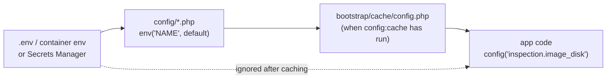

# Environment configuration

> Every setting the application reads, grouped by whether you actually need to touch it. Four
> variables get a local development install running; the rest have sane defaults. Production adds
> three rules: a real `APP_KEY`, a real `APP_URL`, and no secrets in the repository.

**Who this is for:** anyone setting up a `.env`, debugging "it works locally but not on the server",
or reviewing a deployment.
**What you'll learn:** the minimum you must set, what each group of variables controls, how config
caching changes behaviour, and how to handle secrets.
**Just want to run it locally?** [local-setup.md](local-setup.md) has the copy-paste path. This page
is the reference behind it.

---

## The short version

1. **Must set:** `APP_KEY`, `APP_URL`, and the four `DB_*` values. Nothing else is required to boot.
2. **Production must also set:** `APP_ENV=production`, `APP_DEBUG=false`, and real values for the
   seeded account passwords.
3. **Values are read at boot.** After changing `.env`, run `php artisan config:clear` (or restart the
   container). With cached config, only `config/*.php` can read `env()`.
4. **Never commit secrets.** `.env.example` is a template with demo values; `.env` is per-machine.
5. **Prefer IAM roles over keys** for S3 in AWS, and a secret manager over `.env` in production.

## How it works

Laravel resolves configuration in two steps: `config/*.php` files call `env('NAME', default)` at boot,
and application code reads `config('group.key')`. That indirection exists so that production can run
`php artisan config:cache` and avoid re-reading `.env` on every request.



The practical consequence: **an `env()` call inside a controller still works locally and returns
`null` in production once config is cached.** Always add a key to a config file and read
`config(...)`.

The four inspection and forecast groups are exposed through `config/inspection.php` and
`config/forecast.php`; the rest come from the framework's standard config files.

## Step by step: build a working `.env`

### 1. Start from the template

```bash
cp .env.example .env
php artisan key:generate
```

`key:generate` writes a fresh `APP_KEY`. Do this once per environment; reusing a key across
environments is a mistake, and changing it later logs everyone out.

### 2. Set the must-have values

```dotenv
APP_ENV=local
APP_DEBUG=true
APP_URL=http://localhost:8000
APP_KEY=base64:...            # written by key:generate

DB_CONNECTION=mysql
DB_HOST=127.0.0.1
DB_PORT=3306
DB_DATABASE=garment_defect
DB_USERNAME=root
DB_PASSWORD=
```

**Checkpoint:** `php artisan about` shows the environment, debug flag, and database connection you
expect, and `php artisan config:show app` prints the resolved `url`.

### 3. Decide on storage

Leave `INSPECTION_IMAGE_DISK=local` unless you are testing S3. For S3 or MinIO, set:

```dotenv
FILESYSTEM_DISK=s3
INSPECTION_IMAGE_DISK=s3
AWS_DEFAULT_REGION=us-east-1
AWS_BUCKET=garment-inspection-images
# MinIO only:
AWS_ENDPOINT=http://minio:9000
AWS_USE_PATH_STYLE_ENDPOINT=true
```

Use `AWS_ACCESS_KEY_ID` and `AWS_SECRET_ACCESS_KEY` only for MinIO or a non-AWS S3 provider. In AWS,
attach an IAM task role and leave the keys blank.

### 4. Adjust the contract only if you mean it

The ingestion windows default to values that suit the demo:

```dotenv
INSPECTION_ONLINE_THRESHOLD_MINUTES=15
INSPECTION_BACKFILL_DAYS=7
INSPECTION_FUTURE_TOLERANCE_MINUTES=5
INSPECTION_IMAGE_MAX_KB=5120
INSPECTION_IMAGE_MAX_DIMENSION=4096
FORECAST_MAX_PREDICTIONS=500
FORECAST_MAX_HORIZON_MINUTES=10080
```

Changing these changes what producers may send. Coordinate with the inference and forecasting teams
before tightening `INSPECTION_BACKFILL_DAYS`, `INSPECTION_FUTURE_TOLERANCE_MINUTES`, or the image
limits; tightening them silently rejects payloads that used to work.

### 5. Set the seeded passwords before seeding anything shared

```dotenv
ADMIN_EMAIL=admin@garment.test
ADMIN_PASSWORD=change-me-admin-password
OPERATOR_PASSWORD=change-me-operator-password
```

These are read only by `php artisan db:seed`. With `APP_ENV=production`, seeding aborts if the
administrator password is missing or still one of the known defaults. Re-running the seeder **resets**
these accounts' passwords to whatever `.env` holds at that moment.

### 6. Production: inject, don't commit

Set `APP_ENV=production` and `APP_DEBUG=false`, then supply `APP_KEY`, `DB_PASSWORD`,
`ADMIN_PASSWORD`, and `OPERATOR_PASSWORD` from your platform's secret store. The container
entrypoint refuses to start in production without `APP_KEY`. See [deployment.md](deployment.md) for
the ECS/Secrets Manager wiring.

## Reference

### Must set

| Variable | Local default | Why it matters if wrong |
| --- | --- | --- |
| `APP_KEY` | empty | Encryption, sessions, and signed URLs break. Regenerating logs everyone out. Required in the container: the image has no `.env`, so it cannot generate one at startup. |
| `APP_URL` | `http://localhost:8000` | Signed image URLs are generated from it; a mismatch produces links that fail signature validation. Must include scheme and host. |
| `DB_CONNECTION` | `mysql` | Only `mysql` is exercised by the codebase and tests. |
| `DB_HOST` | `127.0.0.1` | |
| `DB_PORT` | `3306` | |
| `DB_DATABASE` | `garment_defect` | The test suite uses `garment_defect_test` from `phpunit.xml`, not this value. |
| `DB_USERNAME` | `root` | Use a dedicated application user in production. |
| `DB_PASSWORD` | empty | Inject from a secret store in production. |

### Production-only essentials

| Variable | Value | Note |
| --- | --- | --- |
| `APP_ENV` | `production` | Enables the stricter seeding checks and disables debug output. |
| `APP_DEBUG` | `false` | `true` in production leaks stack traces and config. |
| `LOG_CHANNEL` | `stderr` | Container logs are collected from stderr. |
| `LOG_LEVEL` | `info` or `warning` | `debug` is noisy and can capture sensitive payloads. |

> The runtime image already sets `APP_ENV=production`, `APP_DEBUG=false`, `LOG_CHANNEL=stderr`,
> `CACHE_STORE=file`, `SESSION_DRIVER=file`, `QUEUE_CONNECTION=sync`, and `RUN_MIGRATIONS=false` as
> image defaults. The task definition overrides cache and sessions to `database` so multiple
> replicas share state. Know which layer wins: task definition beats image default, image default
> beats config-file default.

### Usually set

| Variable | Default | Controls |
| --- | --- | --- |
| `APP_NAME` | `Garment QC` | UI title and mail display name |
| `APP_DISPLAY_TIMEZONE` | `Asia/Manila` | Rendering zone only; storage is always UTC |
| `INSPECTION_IMAGE_DISK` | `local` | Which disk holds inspection images (`local` or `s3`) |
| `FILESYSTEM_DISK` | `local` | Framework default disk; `INSPECTION_IMAGE_DISK` falls back to it |
| `INSPECTION_ONLINE_THRESHOLD_MINUTES` | `15` | How recently a device must have reported to count as online |
| `INSPECTION_BACKFILL_DAYS` | `7` | Oldest accepted `inspected_at` |
| `INSPECTION_FUTURE_TOLERANCE_MINUTES` | `5` | Allowed clock skew into the future |
| `INSPECTION_IMAGE_MAX_KB` | `5120` | Upload size ceiling |
| `INSPECTION_IMAGE_MAX_DIMENSION` | `4096` | Per-axis pixel ceiling |
| `FORECAST_MAX_PREDICTIONS` | `500` | Points allowed in one forecast submission |
| `FORECAST_MAX_HORIZON_MINUTES` | `10080` | Largest declared horizon (7 days) |
| `ADMIN_EMAIL` | `admin@garment.test` | Administrator login created by the seeder |
| `ADMIN_PASSWORD` | `password` in `.env.example` | Seeder only; required in production |
| `OPERATOR_PASSWORD` | `password` in `.env.example` | Seeder only; random when unset in production |

### Object storage

| Variable | Default | Note |
| --- | --- | --- |
| `AWS_ACCESS_KEY_ID` | empty | Prefer an IAM task role in AWS |
| `AWS_SECRET_ACCESS_KEY` | empty | Same |
| `AWS_DEFAULT_REGION` | `us-east-1` | Must match the bucket's region |
| `AWS_BUCKET` | empty | Private inspection bucket |
| `AWS_URL` | empty | Optional CDN or custom base URL |
| `AWS_ENDPOINT` | empty | Set for MinIO or other S3-compatible services |
| `AWS_USE_PATH_STYLE_ENDPOINT` | `false` | `true` for MinIO |

The bucket must stay private. The API returns 10-minute signed URLs; it never exposes a public object
URL.

### Sessions, cache, queue, mail

| Variable | Default | Note |
| --- | --- | --- |
| `SESSION_DRIVER` | `database` | Database sessions survive container replacement; `file` is fine for one container |
| `SESSION_LIFETIME` | `120` | Minutes |
| `SESSION_ENCRYPT` | `false` | |
| `SESSION_DOMAIN` | `null` | Set when sharing cookies across subdomains |
| `CACHE_STORE` | `database` | Use `database` or Redis when running more than one replica |
| `QUEUE_CONNECTION` | `database` | **No jobs are dispatched**; the connection is configured but idle. The image default is `sync` |
| `BROADCAST_CONNECTION` | `log` | No broadcasting is implemented |
| `MAIL_MAILER` | `log` | No mail is sent by any implemented feature |
| `REDIS_*` | localhost | Only relevant if you switch a driver to Redis |
| `BCRYPT_ROUNDS` | `12` | Drop to `4` in tests only |

Sessions on `file` in a multi-replica service produce random logouts; the ECS task definition
therefore uses `database`.

### Less common application settings

| Variable | Default | Note |
| --- | --- | --- |
| `APP_LOCALE`, `APP_FALLBACK_LOCALE`, `APP_FAKER_LOCALE` | `en`, `en`, `en_US` | No translations are shipped |
| `APP_MAINTENANCE_DRIVER` | `file` | `php artisan down` honours this |
| `LOG_STACK`, `LOG_DEPRECATIONS_CHANNEL` | `single`, `null` | |
| `VITE_APP_NAME` | `${APP_NAME}` | Baked into the compiled frontend at build time |

### Container runtime flags

Read by `docker/entrypoint.sh`, **not** by Laravel. They are ignored when running `php artisan serve`.

| Variable | Default | Effect |
| --- | --- | --- |
| `WAIT_FOR_DB` | `false` | Poll MySQL before continuing |
| `DB_WAIT_ATTEMPTS` | `30` | Polls, two seconds apart, before exiting |
| `RUN_MIGRATIONS` | `false` | Run `php artisan migrate --force` at start |
| `RUN_SEED` | `false` | Run `php artisan db:seed --force` at start |
| `OPTIMIZE` | `true` | Cache config, routes, views, and events |

`RUN_MIGRATIONS=true` on every replica of a rolling deployment races on schema changes. Use it for a
single-container demo, and run migrations as a one-off task everywhere else.

### How to inspect effective values

```bash
php artisan about                  # environment, debug, drivers, cache status
php artisan config:show app        # resolved application config
php artisan config:show inspection # thresholds and image limits
php artisan config:show forecast   # metric catalogue and limits
php artisan config:show filesystems
```

If a value looks wrong, check in this order: `.env` (or container env) → `config/*.php` default →
cached config. `php artisan optimize:clear` removes the cache.

## Secrets

1. **Never commit** `APP_KEY`, database passwords, seeded passwords, AWS keys, or Sanctum tokens.
   `.env` and `.env.docker` are per-machine files.
2. **Never bake secrets into the image.** Build arguments are visible in image history. Inject at
   runtime.
3. **One secret per concern.** `APP_KEY`, database password, and bootstrap passwords belong in
   separate secret entries with separate rotation.
4. **Rotate deliberately.** A new `APP_KEY` invalidates sessions and any encrypted value. Rotating the
   database password requires a task restart.
5. **Use IAM roles in AWS.** The task role grants S3 access; do not ship static keys to Fargate.
6. **Revoke tokens instead of sharing them.** One Sanctum token per producer, revoked from
   **Settings → Service API tokens** when decommissioned.

## Common problems

| Symptom | Cause | Fix |
| --- | --- | --- |
| Changes to `.env` have no effect | Config is cached | `php artisan config:clear` (or `optimize:clear`) |
| `No application encryption key has been specified` | `APP_KEY` empty | `php artisan key:generate` |
| Signed image URLs return `403`/`SignatureDoesNotMatch` | `APP_URL` does not match the URL being used | Set `APP_URL` to the exact public scheme and host |
| `env()` returns `null` in production code | Config was cached; `env()` only works in `config/*.php` | Add the key to a config file and read `config(...)` |
| Sessions drop on every deploy | `SESSION_DRIVER=file` with multiple replicas | Use `database` (or Redis) |
| Two replicas disagree about cache | `CACHE_STORE=file` | Use `database` or Redis |
| Seeding aborts in production | Default or missing `ADMIN_PASSWORD` | Set a strong value in the secret store |
| `Access denied` for the database | Wrong `DB_*` values, or cached config | Fix values, `php artisan config:clear` |
| Container exits immediately with "APP_KEY is not set" | Production requires an injected key | Provide `APP_KEY` from the secret store |
| Images vanish after a restart with Compose | `storage/app` was not a volume | Keep the `app-storage` volume mounted |

More environment-level symptoms, including Docker and deploy failures, are indexed in
[troubleshooting.md](troubleshooting.md).

## Related

- Copy-paste local setup: [local-setup.md](local-setup.md)
- Image, Compose, ECS, and secret wiring: [deployment.md](deployment.md)
- GitHub → AWS credentials: [aws-oidc.md](aws-oidc.md)
- Implementation-level variable list: [`../ai-docs/12-configuration-and-environment.md`](../ai-docs/12-configuration-and-environment.md)
