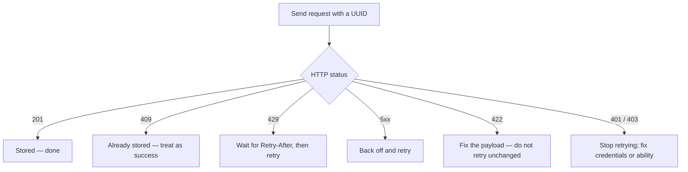

# Integration contracts

> The agreement between this backend and the services that feed it. If you are building the inference
> service, a cloud forecaster, or a network forecaster, implement against this page. The dashboard and
> the UI are consumers, not the contract.

**Who this is for:** producers — the people and systems sending us inspection results or forecasts.
**What you'll learn:** what you must send, what we guarantee in return, how to retry safely, and why a
payload was rejected.
**Looking for exact HTTP mechanics?** [api.md](api.md) owns endpoint paths, field tables, and response
envelopes. This page owns producer behaviour.

---

## The short version

1. **Authenticate with a scoped token.** One token per service, stored in a secret manager, never in
   firmware or source control.
2. **Generate the UUID once and reuse it on every retry.** That is what makes ingestion idempotent.
3. **Treat `409` as success.** The result is already stored; do not generate a new UUID.
4. **Send complete evidence.** `defect_count` equals the detection count, and PASS sends
   `detections: []`.
5. **Do not retry `422` unchanged.** Fix the payload first. Do retry `429` and `5xx` with backoff.

## How it works

### Shared conventions

| Topic | Rule |
| --- | --- |
| Base URL | `{APP_URL}/api/v1` |
| Transport | HTTPS everywhere except local development |
| Content type | `application/json`, or `multipart/form-data` only when uploading an image |
| Auth header | `Authorization: Bearer <token>` |
| Accept header | Always send `Accept: application/json` |
| IDs | UUID v4, generated by the producer **before** the first attempt |
| Timestamps | ISO 8601 with `Z` or an explicit offset; the server normalises to UTC |
| Request ID | Echo `X-Request-Id` in bug reports and logs |
| Retries | Exponential backoff; treat documented `409` codes as success |

### Tokens

An administrator creates the token on the server:

```bash
php artisan service:token "Inference Service" \
  --ability=inspections:write --ability=read
```

What you need to know:

- The plain token is printed once. Store it in the producer's secret manager.
- Re-running the command without `--keep-existing` **revokes** that account's previous tokens.
- A token only works while its `SERVICE` account is active. Deactivating the account blocks ingestion
  immediately.
- Tokens are scoped by ability. Do not share one token between the inference service and a forecaster.
- `read` is a separate ability. If the producer also polls read endpoints, include it explicitly.

### Idempotency and retries



The rule that matters: **never generate a new UUID because a request timed out.** A timeout means the
outcome is unknown. Retry with the same UUID:

- if the first attempt was stored, the retry returns `409` and changes nothing;
- if it was not stored, the retry stores it exactly once.

### Handling responses

| Status | Code | Producer action |
| --- | --- | --- |
| `201` | — | Stored successfully |
| `401` | `UNAUTHENTICATED` | Token missing, invalid, or revoked. Alert and stop retrying |
| `403` | `FORBIDDEN` | Token lacks the ability. Fix configuration |
| `403` | `ACCOUNT_INACTIVE` | Service account disabled. Alert an administrator |
| `409` | `DUPLICATE_INSPECTION` / `DUPLICATE_FORECAST` | Already stored. Treat as success |
| `422` | `VALIDATION_ERROR` | Fix the payload. Do not retry unchanged |
| `422` | `UNKNOWN_DEVICE` | Register the device first. Do not retry |
| `422` | `CONTRACT_MISMATCH` | Status/count disagree. Fix the payload |
| `429` | `RATE_LIMITED` | Wait for `Retry-After`, then retry |
| `5xx` | `SERVER_ERROR` / `HTTP_ERROR` | Retry with backoff; escalate if persistent |

Validation details are keyed by field path:

```json
{
  "error": {
    "code": "VALIDATION_ERROR",
    "details": {
      "detections.0.confidence": ["The detections.0.confidence field must be between 0 and 1."],
      "defect_count": ["defect_count (2) must equal the number of submitted detections (0)."]
    }
  }
}
```

Rate limits and their headers are listed in [api.md](api.md#rate-limits).

## Step by step: connect a producer

1. **Agree the identity.** Pick the service account (`Inference Service`, `Cloud Forecaster`, or
   `Network Forecaster`) and issue a token with only the abilities it needs.
2. **Register the device** in the UI (administrators only) before sending inspections. The
   `device_code` must match exactly, for example `DEVICE-001`.
3. **Build the payload** from the recipe below. Generate the UUID once.
4. **Send it** to the correct endpoint with the right token.
5. **Handle the response** using the matrix above. Persist the UUID alongside your local record so a
   later retry reuses it.
6. **Verify on the dashboard** — the inspection should appear in history and the device should show a
   fresh `last_seen_at`.
7. **Monitor.** Capture `X-Request-Id`, response time, and non-201 counts. Alert on `401`, `403`, and a
   sustained rise in `422` or `5xx`.

### Recipe: inspection result

Full field rules live in [api.md](api.md#post-inspectionsresults). The producer-facing requirements
are:

| Requirement | Why |
| --- | --- |
| One `inspection_id` per physical inspection, reused on retry | Idempotency |
| `device_code` exactly as registered | Device resolution; `device_id` is a legacy alias only |
| `defect_count == count(detections)` | The backend rejects mismatches rather than repairing them |
| `PASS` only with zero detections; `DEFECT` with at least one | Status is derived from evidence |
| `detections: []` for a PASS | The field must be present, even when empty |
| Original detection order preserved | Stored as `detection_index` |
| One `model_version` for the producing model | Traceability |
| Bounding box: all four fields or none | Partial boxes are rejected |

```json
{
  "inspection_id": "a3baacb9-527b-4ab5-adeb-0b7c4e2b775c",
  "device_code": "DEVICE-001",
  "inspected_at": "2026-11-16T04:54:18Z",
  "overall_status": "DEFECT",
  "defect_count": 2,
  "processing_time_ms": 812,
  "model_version": "v1.1",
  "metadata": { "batch": "B-1042", "fabric": "cotton-poplin" },
  "detections": [
    {
      "defect_class": "hole",
      "confidence": 0.9412,
      "bounding_box": { "x": 120, "y": 80, "width": 60, "height": 55 },
      "metadata": { "model_anchor": "yolo-v8" }
    },
    { "defect_class": "stain", "confidence": 0.88 }
  ]
}
```

### Recipe: inspection with an image

Send `multipart/form-data` with exactly two parts:

| Part | Content |
| --- | --- |
| `payload` | The JSON document above, as a string |
| `image` | JPEG, PNG, or WebP |

```bash
curl -X POST "$APP_URL/api/v1/inspections/results" \
  -H "Authorization: Bearer $TOKEN" \
  -H "Accept: application/json" \
  -F 'payload={"inspection_id":"...","device_code":"DEVICE-001","inspected_at":"2026-11-16T04:54:18Z","overall_status":"PASS","defect_count":0,"model_version":"v1.1","detections":[]}' \
  -F "image=@fabric.jpg;type=image/jpeg"
```

Image rules:

- Maximum size `INSPECTION_IMAGE_MAX_KB` (5120 KB by default).
- Maximum dimension `INSPECTION_IMAGE_MAX_DIMENSION` (4096 px by default, per axis).
- The server generates the storage name from the inspection UUID. Never send a filename or path.
- Images are private. The response contains an `image_url` valid for **10 minutes**; treat it as
  sensitive. If an image is optional for a given inspection, omit the file — do not send an empty or
  corrupt one.

### Recipe: forecast

Both sources share one shape. Full field rules live in
[api.md](api.md#post-forecastscloud-and-post-forecastsnetwork).

| Requirement | Why |
| --- | --- |
| One `forecast_id` per forecast run, reused on retry | Idempotency, scoped per source |
| Send every point you want displayed | The backend never fills gaps |
| One `metric_name` per series, consistent unit | Charts group by metric |
| `generated_at` at generation time, not delivery time | History ordering and warnings |
| At most `FORECAST_MAX_PREDICTIONS` points (500 default) | Request size limit |
| `(metric_name, predicted_at)` unique within one submission | Prevents duplicate points |

`predicted_at` should fall inside the declared horizon. This is a producer responsibility; the backend
does not reject out-of-horizon points, but they will look odd on the chart.

```json
{
  "forecast_id": "097a83a7-0473-45af-a1bf-0df1b03ddb88",
  "model_name": "cloud-lstm",
  "model_version": "v9.9",
  "forecast_horizon_minutes": 120,
  "generated_at": "2026-11-16T04:55:03Z",
  "metadata": { "region": "ap-southeast-1" },
  "predictions": [
    {
      "metric_name": "cpu_utilization",
      "metric_unit": "%",
      "predicted_value": 71.4,
      "actual_value": 68.2,
      "predicted_at": "2026-11-16T05:25:03Z",
      "anomaly_risk": 0.82,
      "risk_level": "HIGH"
    },
    {
      "metric_name": "memory_utilization",
      "metric_unit": "%",
      "predicted_value": 88.0,
      "predicted_at": "2026-11-16T05:25:03Z",
      "risk_level": "CRITICAL"
    }
  ]
}
```

### Clock and backfill

- The backend stores `received_at` separately from `inspected_at`. Keep device clocks synchronised
  with NTP; more than 5 minutes of future skew is rejected.
- Inspections older than `INSPECTION_BACKFILL_DAYS` (7 by default) are rejected. If a camera was
  offline longer than that, contact an administrator **before** replaying the backlog.
- Forecast `generated_at` may be at most 5 minutes in the future. Older generated times are accepted,
  but a late submission still supersedes the current active forecast.

## Reference

### Supersede semantics

```text
forecast A (ACTIVE)
        │
        └── forecast B accepted ──► A = SUPERSEDED, B = ACTIVE
```

- Only one forecast per source is intended to be `ACTIVE`.
- Superseding happens in the same transaction as the insert.
- History is retained and visible in the forecast history table.
- A duplicate `(source_type, forecast_id)` returns `409` and changes nothing. A retry of an
  already-stored forecast must **not** supersede the current one.
- The same UUID may be used once for `CLOUD` and once for `NETWORK`; uniqueness is scoped by source.
- Supersede is source-scoped: a cloud submission never touches network forecasts.
- `EXPIRED` exists in the enum but is never assigned; do not rely on it.

### Metric catalogues

Configured cloud metrics:

| Metric | Label | Unit |
| --- | --- | --- |
| `cpu_utilization` | CPU Utilization | % |
| `memory_utilization` | Memory Utilization | % |
| `disk_io_read` | Disk Read I/O | MB/s |
| `disk_io_write` | Disk Write I/O | MB/s |
| `network_in` | Network In | Mbps |
| `network_out` | Network Out | Mbps |

Configured network metrics:

| Metric | Label | Unit |
| --- | --- | --- |
| `network_throughput` | Network Throughput | Mbps |
| `packet_count` | Packet Count | pps |
| `traffic_volume` | Traffic Volume | MB |
| `latency` | Latency | ms |
| `packet_loss` | Packet Loss | % |
| `congestion_risk` | Congestion Risk | % |

Unlisted metric names are accepted if they match `^[a-z0-9_]+$`; they appear with a humanised label
and no unit unless you send one. Agree new names and units with the dashboard owner so charts stay
readable.

### Deliberately rejected shapes

| Shape | Reason |
| --- | --- |
| `defect_count: 0` with `overall_status: "DEFECT"` | A defect must have at least one detection |
| `defect_count: 2` with `detections: []` | Count must match the array |
| `defect_count: 1` with `overall_status: "PASS"` | PASS must contain zero detections |
| Missing `detections` | Must be explicit, even when empty |
| Unknown `device_code` | Devices must be registered first |
| `inspected_at` beyond the future tolerance | Keeps trends and device liveness honest |
| `inspected_at` older than the backfill window | Prevents silent historical rewrites |
| Duplicate `inspection_id` | Evidence is append-only |
| Duplicate metric/time pair in one forecast | One value per metric per timestamp |
| Empty `predictions` | A forecast with no points is not useful |

### Producer acceptance checklist

- [ ] Token stored in a secret manager, scoped to one service's abilities.
- [ ] UUID generated once per inspection/forecast and reused on every retry.
- [ ] `409` treated as success, not as an error to fix.
- [ ] Device clock synchronised; every timestamp includes an offset or `Z`.
- [ ] PASS sends `detections: []`; DEFECT sends at least one detection.
- [ ] `defect_count` equals the detection array length.
- [ ] Bounding boxes are complete or absent.
- [ ] Images are sent only through the multipart `image` part.
- [ ] Forecast metric names are lower snake case and units are consistent.
- [ ] `Retry-After` and `X-RateLimit-*` are honoured.
- [ ] `X-Request-Id` is captured in producer logs for support.
- [ ] `401`, `403`, and sustained `422`/`5xx` trigger an alert.

### Versioning and change management

- The API is versioned in the path (`/api/v1`). A breaking change ships as `/v2`.
- Additive response fields may appear in v1 at any time; ignore unknown fields.
- `model_version` is free text that should identify the deployed model, for example
  `yolo-v8-2026-11`.
- New defect classes and metric names do not require a backend release.
- Unknown request fields are ignored, not rejected. Do not rely on that as validation.
- If a producer needs a new required field, coordinate a migration window rather than shipping it
  unilaterally.

## Common problems

| Symptom | Likely cause | Fix |
| --- | --- | --- |
| `422` says `defect_count` does not match detections | Producer computed the count before filtering low-confidence boxes | Compute the count from the final array |
| `422` says `overall_status must be PASS` | Detection array is empty but status says DEFECT | Derive status from the array |
| `422` says `detections` is required | Field omitted for a PASS | Send `"detections": []` |
| `422 UNKNOWN_DEVICE` | Code typo, lowercase code, or device not registered | Match the registered code exactly |
| `422` on `inspected_at` | Device clock drift or a backlog older than 7 days | Sync with NTP; talk to an administrator about backfill |
| `409` on every retry | Producer regenerates the UUID | Persist and reuse the original |
| `429` repeatedly | Bursting above the token's rate limit | Back off; spread submissions |
| `401` after working previously | Token revoked or service account changed | Re-issue the token |
| `403` on a read call | Token has `inspections:write` but no `read` | Add `read` when issuing |
| Forecast points missing from the chart | Metric had no stored predictions | Send every point; the backend does not fill gaps |
| Two forecasts show as active | Concurrent submissions; supersede is not serialised | Serialise submissions per source |

## Related

- Exact endpoints, fields, and envelopes: [api.md](api.md)
- Why ingestion is transactional: [architecture.md](architecture.md)
- Stored columns and constraints: [database.md](database.md)
- Implementation-level contract detail: [`../ai-docs/07-api-documentation.md`](../ai-docs/07-api-documentation.md)
