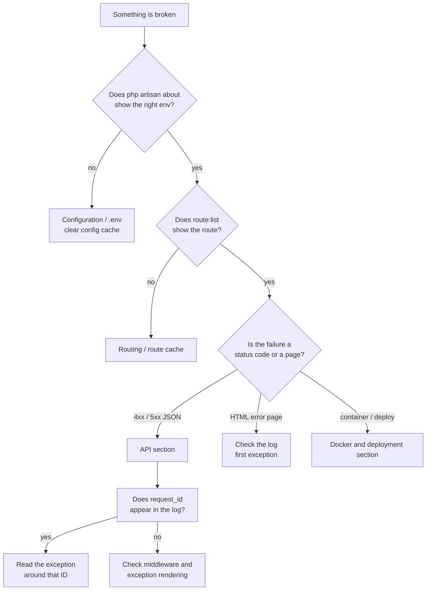

# Troubleshooting

> Symptom first, cause second, fix third. Start with the table that matches what you were doing, then
> follow the link to the page that owns the detail.

**Who this is for:** anyone stuck — a new developer whose first `php artisan serve` failed, a producer
whose payload is rejected, or an operator whose task will not go healthy.
**How to use it:** search this page for the exact error text, find the matching row, apply the fix. If
the symptom is not here, collect the diagnostics below and widen the search in the owning page.

---

## The short version

| If the failure is about… | Look here |
| --- | --- |
| Installing, migrating, or serving locally | [Setup and runtime](#setup-and-runtime) |
| A database connection or query | [Database](#database) |
| Styling, charts, or the Vite build | [Frontend and assets](#frontend-and-assets) |
| Login, sessions, or permissions | [Authentication and sessions](#authentication-and-sessions) |
| An API status code or envelope | [API](#api) |
| An upload or a signed image URL | [Images and storage](#images-and-storage) |
| Compose, the container, or ECS | [Docker and deployment](#docker-and-deployment) |
| GitHub Actions or the AWS role | [CI and OIDC](#ci-and-oidc) |
| A red test or a style failure | [Tests and quality](#tests-and-quality) |

## First 60 seconds

Before chasing a specific error, run these five commands. They answer "which layer is broken?" in
under a minute.

```bash
php artisan about
php artisan config:clear
php artisan route:list --except-vendor
php artisan migrate:status
tail -n 50 storage/logs/laravel.log
```

| Result | Meaning |
| --- | --- |
| `about` shows the wrong environment or driver | Configuration problem — see [environment.md](environment.md) |
| `config:clear` fixes behaviour | Stale cached config — always clear after editing `.env` |
| `route:list` is missing a route | Route cache or a route file not loaded — `php artisan route:clear` |
| `migrate:status` shows `Pending` | Schema is behind — `php artisan migrate` |
| The log has a stack trace | Read the **first** exception, not the last line |



Collect these four things for any bug report:

1. The **status code** and the response body (API) or the exception class (web).
2. The `X-Request-Id` from the response or the `request_id` in the body.
3. The env layer: `php artisan about` locally, or the task definition revision in AWS.
4. What changed immediately before it broke — `.env`, a migration, a deploy, or a provider payload.

## Setup and runtime

| Symptom | Cause | Fix |
| --- | --- | --- |
| `could not find driver` | `pdo_mysql` is not enabled | Enable it in `php.ini`, restart the terminal |
| `No application encryption key has been specified` | `APP_KEY` empty | `php artisan key:generate` |
| `Vite manifest not found at: ...` | Assets were never built | `npm install && npm run build` |
| `npm: command not found` | Node is not on `PATH` | Add the Node install directory to `PATH` |
| `Failed to listen on 127.0.0.1:8000` | Port 8000 is taken | `php artisan serve --port=8001` and update `APP_URL` |
| `419 Page Expired` | Session expired or a form without `@csrf` | Reload; add `@csrf` to hand-written forms |
| `php artisan test` says the test database is missing | `garment_defect_test` was never created | Create it — see [local-setup.md](local-setup.md#1-create-the-two-databases) |
| `Class not found` after pulling | Stale autoloader or new dependency | `composer install` then `composer dump-autoload` |
| Commands behave differently after a `.env` edit | Cached config | `php artisan config:clear` |

Owner: [local-setup.md](local-setup.md) owns install, run, seed, and reset.

## Database

| Symptom | Cause | Fix |
| --- | --- | --- |
| `SQLSTATE[HY000] [1045] Access denied` | Wrong `DB_USERNAME`/`DB_PASSWORD` | Fix `.env`, then `php artisan config:clear` |
| `SQLSTATE[HY000] [2002] Connection refused` | MySQL not running, or wrong host/port | Start MySQL; check `DB_HOST` and `DB_PORT` |
| `SQLSTATE[HY000] [1049] Unknown database 'garment_defect'` | The database was never created | Run the `CREATE DATABASE` command |
| `SQLSTATE[HY000] [1049] Unknown database 'garment_defect_test'` | Test database missing | Create `garment_defect_test` |
| `Cannot delete or update a parent row` | Deleting a device that still has inspections | Deactivate the device; inspections are evidence |
| Duplicate row despite a uniqueness rule | The rule is application-only (for example one active forecast) | Fix the writer; the schema does not enforce it |
| Counts look shifted by hours | Comparing local time against UTC columns | Use `UTC_TIMESTAMP()`; render with `display_datetime()` |
| A soft-deleted device still appears in raw SQL | Eloquent adds `deleted_at IS NULL`; raw SQL does not | Add `WHERE deleted_at IS NULL` |
| `php artisan migrate:fresh` would drop data | It drops every table in `DB_DATABASE` | Never run it against shared or production data |

Owner: [database.md](database.md) owns schema, constraints, and queries.

## Frontend and assets

| Symptom | Cause | Fix |
| --- | --- | --- |
| Page has no styling | Assets never built, or a stale manifest | `npm run build`, then hard-refresh the browser |
| Charts are blank | A JavaScript error, or no data for the window | Open the console; check the panel's query range |
| Changes to Blade/CSS do not appear | View cache, or you are serving stale assets | `php artisan view:clear`; use `npm run dev` while editing |
| `Unable to locate file in Vite manifest` | The view references an asset not in the build | Rebuild; check the entry name in `vite.config.js` |
| `npm ci` fails after a dependency change | Lockfile out of sync | `npm install`, commit the updated lockfile |
| Alpine behaviour stops after a partial update | Two Alpine instances, or a script error before init | Load Alpine once via the Vite entry; check the console |

Owner: [local-setup.md](local-setup.md) owns the build commands; [`../ai-docs/08-frontend-documentation.md`](../ai-docs/08-frontend-documentation.md)
owns frontend detail.

## Authentication and sessions

| Symptom | Cause | Fix |
| --- | --- | --- |
| Login rejects a seeded account | `db:seed` ran with different `.env` values | Re-run `php artisan db:seed`, or reset the password |
| A `SERVICE` account cannot sign in | Service accounts are rejected at login by design | Use the web UI with a staff account; service accounts are token-only |
| Random logouts across replicas | `SESSION_DRIVER=file` with more than one container | Use `database` (or Redis) |
| Everyone is logged out after a deploy | `APP_KEY` changed | Keep the key stable; a new key invalidates sessions |
| Signed-in user is bounced to `/login` | The account was deactivated (`is_active=false`) | Reactivate it in user management |
| `403` on an admin page for an administrator | Wrong role, or a policy denial | Check the `role` column; hidden UI is not authorization |
| Cannot deactivate the last administrator | The last-admin guard blocks it | Promote another administrator first |

Owner: [`../ai-docs/10-authentication-and-authorization.md`](../ai-docs/10-authentication-and-authorization.md)
owns guards, policies, and the last-administrator rule.

## API

| Symptom | Cause | Fix |
| --- | --- | --- |
| `401 UNAUTHENTICATED` with a token you just created | Header missing, malformed, or token revoked | Send `Authorization: Bearer <token>`; re-issue if revoked |
| `403 FORBIDDEN` on a `GET` | The token lacks `read` | Issue a token with `--ability=read` |
| `403 ACCOUNT_INACTIVE` | The owning service account was deactivated | Reactivate it, or issue a token for an active account |
| `404 NOT_FOUND` on an inspection | Wrong identifier — the path needs the UUID | Use `inspection_id`, not the numeric `id` |
| `409 DUPLICATE_INSPECTION` | Retry of an already-stored UUID | Treat as success; do not generate a new UUID |
| `409 DUPLICATE_FORECAST` | Same `forecast_id` already stored for that source | Treat as success |
| `422 VALIDATION_ERROR` on `detections` | Field omitted instead of sent as `[]` | Always send `detections`, even for PASS |
| `422` says `defect_count` does not match | Count computed before filtering detections | Compute the count from the final array |
| `422 UNKNOWN_DEVICE` | Device code not registered, or different case | Match the registered code exactly |
| `422` on `inspected_at` | Clock skew, or older than the backfill window | Sync with NTP; replay within `INSPECTION_BACKFILL_DAYS` |
| `429 RATE_LIMITED` | Too many requests for the token owner | Wait for `Retry-After`, then retry |
| `500 SERVER_ERROR` | Unexpected failure | Retry with backoff; report the `request_id` |
| `latest=1` returns `data: null` | No `ACTIVE` forecast for that source | Ingest one, or check the source URL |
| Forecast history has no `predictions` | History mode does not eager-load them | Use `latest=1` or the web forecast detail page |
| An error body has an unexpected shape | Exception rendering in `bootstrap/app.php` | Confirm the endpoint is under `/api/*` |
| `/health` returns `503` | Database unreachable | Check `DB_*` values and MySQL availability |

Owner: [api.md](api.md) owns endpoints and envelopes; [integration-contracts.md](integration-contracts.md)
owns producer retry behaviour.

## Images and storage

| Symptom | Cause | Fix |
| --- | --- | --- |
| `image_url` is `null` but an image was sent | No stored path, or URL generation failed | Check `image_path`, the disk, and the file's existence |
| `404` when opening an image | Missing object, or the wrong disk | Check `INSPECTION_IMAGE_DISK` and the storage location |
| Image opens, then expires | Signed URLs live for 10 minutes | Re-read the inspection to get a fresh URL |
| `SignatureDoesNotMatch` / `403` on a signed URL | `APP_URL` differs from the URL being used | Set `APP_URL` to the exact public scheme and host |
| Uploads rejected as too large | Exceeds `INSPECTION_IMAGE_MAX_KB`, or Nginx's 8 MB body limit | Raise the limit, or downscale the image |
| Uploads rejected as too many pixels | Exceeds `INSPECTION_IMAGE_MAX_DIMENSION` per axis | Downscale before sending |
| `AccessDenied` uploading to S3 | Task role lacks permission, or the bucket is wrong | Fix the task role policy and `AWS_BUCKET` |
| Images disappear after a container restart | Local disk without a volume | Mount a volume, or use S3 |
| Images appear in the UI but not via the API | The UI route uses the session; the API uses a signed URL | Check `APP_URL` and the disk config |

Owner: [architecture.md](architecture.md) explains the storage model; [deployment.md](deployment.md)
covers bucket permissions.

## Docker and deployment

| Symptom | Cause | Fix |
| --- | --- | --- |
| `docker ps` fails with a named-pipe error | Docker Desktop is not running | Start Docker Desktop and wait for the engine |
| Compose exits: `Set DB_PASSWORD in .env.docker` | Required substitution missing | Replace every `change-me` value |
| Container exits: `APP_KEY is not set` | Production requires an injected key | Provide `APP_KEY` from a secret store |
| App restart-loops with `file_get_contents(/var/www/html/.env): Failed to open stream` | `APP_KEY` empty in Compose; the image has no `.env` to write | Set `APP_KEY` in `.env.docker` |
| `db` exits 127 with `libselinux.so.1: file too short` | Corrupted MySQL image layer | Remove the image and pull a different patch tag |
| Container keeps restarting | Database unreachable, or a failed migration | Set `WAIT_FOR_DB=true`, check security groups, read the logs |
| ALB marks the task unhealthy | `/up` unreachable, or the wrong port | Confirm a 200 from `/up` on port 80 inside the container |
| Deploy stalls at `services-stable` | New tasks never become healthy | Inspect the stopped reason and logs; roll back if needed |
| Migration task exits non-zero | SQL error, bad credentials, or a failed prior migration | Read the exit code and CloudWatch; fix forward |
| Seeded password reverts after a restart | `RUN_SEED=true` | Set `RUN_SEED=false` after the first start |
| Two replicas disagree about cache | `CACHE_STORE=file` | Use `database` or Redis |
| Logs are empty in CloudWatch | Wrong log group or region in the task definition | Fix `awslogs-group` / `awslogs-region` |

Owner: [deployment.md](deployment.md) owns image, Compose, ECS, and operations.

## CI and OIDC

| Symptom | Cause | Fix |
| --- | --- | --- |
| CI fails at `php artisan test` | Missing `garment_defect_test`, or a real test failure | Read the failing test; the workflow creates the database |
| CI fails at Pint | Style violation | `vendor/bin/pint` locally, then commit |
| CI fails at `view:cache` | A Blade syntax error | Fix the template; run `php artisan view:cache` locally |
| Container job never healthy | Startup error inside the image | Reproduce with `docker run` and read the logs |
| Deploy: `Not authorized to perform sts:AssumeRoleWithWebIdentity` | Trust policy `sub`/`aud` mismatch | Match the exact repository and environment claim |
| Deploy: `No OpenID Connect provider found` | Provider URL differs, or wrong account | Create it with the exact URL |
| Deploy: `AccessDenied` on ECR push | Repository ARN or image name mismatch | Fix the policy resource |
| Deploy: `AccessDenied` on `iam:PassRole` | Execution/task role ARNs wrong | Correct the ARNs; keep the ECS condition |
| Deploy: `ResourceNotFoundException` on ECS | Wrong cluster, service, or task family | Fix the repository variables |
| Deploy fails at "Validate deployment configuration" | A required variable or secret is missing | Set all five variables and `AWS_DEPLOY_ROLE_ARN` |
| Migration step skipped | Subnet or security-group variable empty | Set both, or run migrations manually |

Owner: [aws-oidc.md](aws-oidc.md) owns the role and repository settings.

## Tests and quality

| Symptom | Cause | Fix |
| --- | --- | --- |
| `Unknown database 'garment_defect_test'` | The test database does not exist | Create it; `RefreshDatabase` handles the schema |
| Tests pass alone but fail together | Shared state or a missing refresh | Use `RefreshDatabase`; avoid order dependence |
| Image-upload test errors about GD | The `gd` extension is missing | Enable `gd` in `php.ini` |
| Tests are slow | `BCRYPT_ROUNDS` left at 12 | `phpunit.xml` already sets `4`; do not override it |
| Pest reports a risky test | No assertions, or output during a test | Add an assertion; remove stray `dump`/`echo` |
| Pint and the test suite disagree | Unformatted code that still runs | Run `vendor/bin/pint` before committing |

Owner: [`../ai-docs/13-testing-and-quality.md`](../ai-docs/13-testing-and-quality.md) owns the suite
layout and CI checks.

## When nothing fits

1. Reproduce with the smallest possible request: `/api/v1/health`, then one read call, then one write.
2. Clear every cache: `php artisan optimize:clear`.
3. Confirm the environment layer: `php artisan about` and `php artisan config:show app`.
4. Read `storage/logs/laravel.log` around the timestamp of the failure, using the `request_id` to
   correlate.
5. Check the owning page's "Common problems" section before changing code.
6. If it is still unexplained, capture the request ID, the status code, the env layer, and what changed,
   and mark the issue `Needs Verification` rather than guessing.

## Related

- Landing page and reading paths: [README.md](README.md)
- Every variable and the config-cache rule: [environment.md](environment.md)
- Endpoint mechanics and error codes: [api.md](api.md)
- Producer-side fixes: [integration-contracts.md](integration-contracts.md)
- Containers, ECS, and health checks: [deployment.md](deployment.md)
- Local install and reset: [local-setup.md](local-setup.md)
